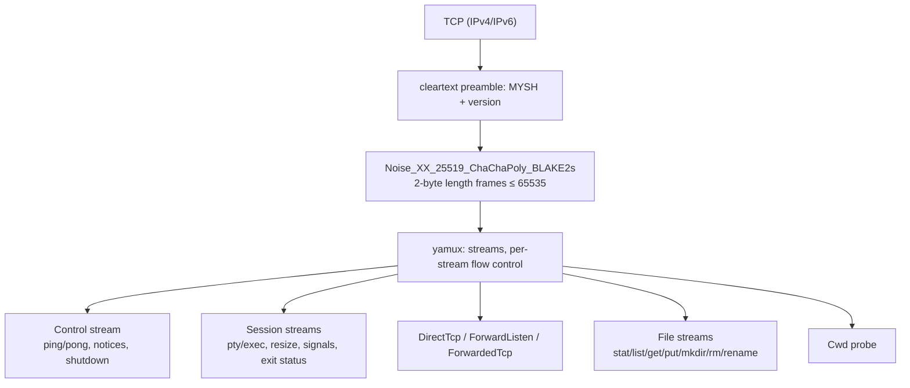

# 01 — Architecture

mysh is a minimal, encrypted remote shell for administering personal servers
and devices. It replaces `ssh` for one operator and a fleet they own; it is
not an SSH implementation and does not aim at multi-tenant hosts.

## Goals

- Mutual authentication and encryption always on; no plaintext or
  unauthenticated mode exists.
- Zero-config **baked** binaries: identity and trusted peers compiled in, no
  files on disk.
- Reuse of existing OpenSSH ed25519 keys, `authorized_keys`, and
  `known_hosts` where that is cheap and sound.
- Interactive PTY sessions that track the client terminal size.
- A **meta shell** as the home screen of every connection: file transfer,
  port forwarding, connection introspection, and any number of real remote
  shells (`shell`), with one key (`Ctrl-]`) to get back to it. The same
  commands exist as CLI subcommands.
- One static binary per platform: Linux (musl), macOS, Android. Client and
  server are the same binary.
- Small enough to read in an afternoon. Boring dependencies.

## Non-goals (v1)

- Multi-user login. The server serves exactly one OS user: whoever ran
  `mysh serve`. No PAM, no privilege separation, no `utmp`/`wtmp`, no
  `~user` switching. (Runs fine as root under systemd/launchd if that is the
  intended user.)
- SSH wire compatibility, `scp`/`sftp` compatibility, X11/agent forwarding.
- Non-ed25519 agent keys (`sk-*`, RSA, ECDSA). ed25519 keys held by an
  `ssh-agent` are supported via signature authentication (02-security.md).
- Windows.
- Post-quantum key exchange, session persistence across disconnects,
  connection multiplexing between client processes (roadmap, 06).

## Deployment modes

| Mode       | Identity                    | Trust                              | Use                                   |
| ---------- | --------------------------- | ---------------------------------- | ------------------------------------- |
| configured | `~/.config/mysh/` key files | `authorized_keys`, `known_hosts`   | daily driver                          |
| baked      | compiled-in                 | compiled-in peers                  | rescue media, adb-pushed binaries     |
| mixed      | baked defaults              | baked peers ∪ files                | fleet binary that also accepts admins |

Mode is a property of the build (`--features baked`) plus the presence of
files; the code paths are identical. `--baked-only` ignores files at runtime.

## Process model

One binary, `mysh`:

```
mysh [opts] HOST [CMD...]       client: interactive session or remote exec
mysh serve [opts]               server
mysh keygen | fingerprint       key utilities
mysh put|get|forward|authorize HOST ...   one-shot meta commands
```

Server: a single tokio multi-thread runtime; one task per connection, one per
stream. No `fork()` except the PTY/exec child, spawned via
`tokio::process::Command` with a `pre_exec` hook. No threads besides tokio's.

Client: same runtime; stdin reader, stdout writer, signal listener, and one
task per forwarded connection.

## Layering



Every stream begins with an `Open` message naming its kind; after an
`OpenReply::Ok` the stream is either raw bytes (TCP forwards, file bodies) or
length-prefixed postcard messages (sessions, control). Details in
03-protocol.md.

## Crates

```
crates/
  mysh-proto   wire constants + serde/postcard message types. No I/O. #![forbid(unsafe_code)]
  mysh-net     preamble, Noise handshake, NoiseStream (AsyncRead/Write), yamux,
               key files, ssh key conversion, authorized_keys/known_hosts. #![forbid(unsafe_code)]
  mysh-pty     platform layer: openpty, spawn with controlling tty, winsize,
               termios raw mode, signal plumbing, cwd-of-pid. Only crate with unsafe.
  mysh-client  lib: everything that drives a server without a terminal —
               config/paths, identities + trust, Connection, sessions (ring,
               remote process API), files/sync, forwards, control-socket
               requester, fleet fan-out, pairing, the `--json` types, and the
               `Client` facade (07-embedding.md). #![forbid(unsafe_code)]
  mysh         bin: cli, console + terminal driver, meta shell, jobs, control-socket
               server, master, MCP server, server (sessions, files, forwards),
               baked keys (build.rs)
```

Dependency direction: `mysh → {mysh-client, mysh-pty} → {mysh-net} → mysh-proto`
(`mysh-client` never depends on `mysh-pty`). All `cfg(target_os = …)` lives in
`mysh-pty` and in `mysh_client::config` (default paths), nowhere else.

Module layout:

```
crates/mysh-client/src/
  lib.rs           Client facade re-exports, Reporter/TrustPrompt, Error
  config.rs        paths, config file, HOST parsing, identity/trust resolution order
  identity.rs      client identities (files, agent), ClientTrust (pin/baked/known_hosts)
  conn.rs          connect: dial, preamble, handshake, trust check, yamux, control stream
  session.rs       session stack (foreground/background, ring replay), exit code mapping
  session_api.rs   remote process API: new/read/send/list/kill/wait by id
  files.rs         put/get/ls/stat/authorize and the file primitives
  fileops.rs       cat/write/tail/mkdir/rm/mv/realpath/hash command runners
  sync.rs          tree comparison and push/pull
  forward.rs       -L/-R/-D listeners, SOCKS5
  ctl.rs           control-socket requester, master spawn (`ensure`)
  fleet.rs         host selection, fan-out
  pair.rs          SPAKE2 pairing client
  types.rs         --json result types, Event stream, error codes
  args.rs          request structs shared with the CLI (clap `Args`)
  report.rs        Reporter (replaces the console), TrustPrompt
  client.rs        Client / Sessions / Files facade
crates/mysh/src/
  main.rs          entry; tracing init; dispatch
  cli.rs           clap definitions (05-meta-shell.md "CLI"); re-exports mysh_client::args
  config.rs, identity.rs, output.rs   re-exports plus the binary-only parts
                   (server identity/trust source, keygen/fingerprint, HelpTree)
  client/
    mod.rs         `mysh HOST` modes: exec, interactive, wait, attach
    console.rs     the terminal writer; implements Reporter and TrustPrompt
    terminal.rs    raw mode, SIGWINCH/SIGTSTP, meta-key interception
    editor.rs      line editor + history
    meta.rs        meta shell: tokenizer, dispatcher, commands
    jobs.rs        background jobs
    ctl.rs         control-socket server; master.rs  `mysh master`
    fleet.rs       `run`/`put`/`get --hosts` over capture consoles
    conn.rs, session.rs, files.rs, …   thin re-exports of mysh_client
  mcp/             `mysh mcp` (07-embedding.md "MCP server")
  server/
    mod.rs         listen loop, per-connection accept, authorization
    session.rs     pty + exec sessions
    forward.rs     DirectTcp dial, ForwardListen bind
    files.rs       file service
```

## Dependencies and why

| crate                          | role                                   | note                                                      |
| ------------------------------ | -------------------------------------- | --------------------------------------------------------- |
| `tokio`                        | runtime, net, process, signals         | multi-thread runtime; `process` reaps children            |
| `snow`                         | Noise handshake + transport            | pure Rust (RustCrypto resolver), `default-features = false` — its `std` feature drags in `ring`; cross-compiles with no C toolchain |
| `yamux` + `tokio-util/compat`  | stream multiplexing, flow control      | libp2p's; `futures-io` traits bridged to tokio             |
| `postcard` + `serde`           | message encoding                       | compact, varint, append-only-compatible enums              |
| `ssh-key`                      | OpenSSH key/authorized_keys/known_hosts parsing | `encryption` feature for passphrase-protected keys |
| `curve25519-dalek`, `sha2`     | ed25519 → X25519 conversion, fingerprints | same majors as `snow`/`ssh-key`                          |
| `rustix`                       | pty, termios, ioctls, process          | one API for Linux/macOS/Android; no `nix`                  |
| `libc` (BSDs + macOS)          | `proc_pidinfo` (macOS), `sysctl` cwd probes (FreeBSD, OpenBSD), `ptsname`/`ptsname_r` (OpenBSD/NetBSD) |                                                            |
| `portable-atomic` (`fallback`) | `AtomicU64` in transfer stats and counters | std's `AtomicU64` does not exist on targets without native 64-bit atomics (armv5te, mips32); `fallback` emulates it with a global lock there and is the std type everywhere else |
| `clap`                         | CLI                                    | derive; `mysh-client` derives `Args` on its request structs (`args`) so the binary, the control socket and the library share one definition |
| `shlex`                        | meta shell tokenizer                   |                                                            |
| (built-in line editor)         | prompt line editing, history           | `client::meta` owns a small editor fed by the stdin reader task; `rustyline` was dropped because it would compete with that task for stdin |
| `rpassword`                    | passphrase and TOFU prompts            |                                                            |
| `dirs`                         | XDG / platform directories             |                                                            |
| `tracing`                      | logging                                | `-v` raises level; never logs key material                 |
| `zeroize`                      | secret wiping                          |                                                            |
| `anyhow` / `thiserror`         | errors in bin / libs                   | `mysh-client` keeps `anyhow` chains internally and tags them with the M6 code at the facade (`mysh_client::Error`) |

Not used, deliberately: `rustls`/TLS (PKI-shaped), `russh` (we are replacing
ssh, not reimplementing it), `crossterm` (too much for raw mode + winsize),
`nix` (rustix covers it), `openssl`.

## Platform matrix

|                 | Linux                              | macOS                          | Android                                                | FreeBSD (cross-compiled only) |
| --------------- | ---------------------------------- | ------------------------------ | ------------------------------------------------------ | ----------------------------- |
| client          | yes                                | yes                            | Termux                                                 | yes (static inspection only, no BSD runtime in CI) |
| server          | yes                                | yes                            | Termux, `adb shell` (shell uid), rooted                | yes (same caveat)             |
| targets         | musl, static: `x86_64`, `aarch64`, `i686`, `armv7` (eabihf), `arm` (v6 eabihf), `riscv64gc`; stretch `armv5te`, `powerpc64le`, `loongarch64`, `s390x` (musl, tier 3), `mipsel`/`mips` (musl, tier 3), `s390x` (gnu) | `aarch64`, `x86_64` + `universal` (`lipo`) | `aarch64`, `armv7`, `x86_64` (API 24); stretch `i686` | `{x86_64,aarch64}-unknown-freebsd`; stretch NetBSD `x86_64` (`aarch64` tier 3) and OpenBSD `x86_64`/`aarch64` (tier 3) |
| pty open        | `posix_openpt`/`/dev/ptmx`         | same                           | same (bionic); needs `devpts`, present in Termux/adb   | same (`pts(4)`; rustix `ptsname` works; NetBSD uses `libc::ptsname_r`, OpenBSD `libc::ptsname` (no `ptsname_r`), both behind cfg) |
| cwd probe       | `/proc/<pid>/cwd`                  | `proc_pidinfo(PROC_PIDVNODEPATHINFO)` | `/proc/<pid>/cwd` (may be denied cross-uid; same uid is fine) | `sysctl(kern.proc.cwd.<pid>)` → one `kinfo_file`, `kf_path`; OpenBSD `sysctl(kern.proc_cwd.<pid>)` → path string; NetBSD `Unsupported` |
| shell detection | `--shell` → `$SHELL` → passwd → `/bin/sh` | same                   | `--shell` → `$SHELL` → `/system/bin/sh`                | same as Linux                 |
| home            | `$HOME` → passwd → `/`             | same                           | `$HOME` → `/data/local/tmp` → `/`                      | same as Linux                 |
| config dir      | `$XDG_CONFIG_HOME/mysh` → `~/.config/mysh` | `~/.config/mysh` (not `~/Library`, keep one path) | `~/.config/mysh` under Termux `$HOME`    | `~/.config/mysh`              |
| run as service  | systemd unit (`contrib/`)          | launchd plist (`contrib/`)     | Termux:Boot script; or `adb shell nohup ... &`         | `rc.d` script (not shipped)   |
| notes           | `getpwuid` via libc                | SIP irrelevant; no sandbox     | PIE required (Rust default); no `getpwnam` data; SELinux may block `/proc` of other uids | default `PATH` adds `/usr/local/sbin:/usr/sbin:/sbin`; linked dynamically against base libc via `cargo zigbuild`; NetBSD (`/usr/pkg` on `PATH`) and OpenBSD (tier 3, `/usr/X11R6/bin` on `PATH`) are stretch targets |

## Build

```sh
cargo build --release                                    # native
scripts/release.sh [--stretch] [TARGET...]               # the release matrix into dist/ (+ SHA256SUMS)
scripts/validate-dist.sh [VERSION]                       # run every Linux artifact under docker + qemu-user
scripts/android-build.sh [TARGET] [API]                  # one android target: NDK clang as linker
MYSH_BAKED_IDENTITY=fleet.secret MYSH_BAKED_PEERS=fleet.pub \
  cargo build --release --features baked                 # baked
cargo check-matrix                                       # type-check every required target, no linkers needed
cargo check-matrix-stretch                               # the stretch targets that ship std
scripts/check-tier3.sh [TARGET...]                       # tier-3 stretch targets: nightly + -Z build-std
cargo lint                                               # clippy -D warnings
scripts/lima-test.sh                                     # full test suite on Linux in a lima VM (scripts/lima.yaml)
```

There are no C dependencies, so every target needs only a *linker*;
`scripts/release.sh` holds the single target table (target, family, tier,
required/stretch) and picks the linker by family:

| family                 | linker                                                   | note                                                                    |
| ---------------------- | -------------------------------------------------------- | ----------------------------------------------------------------------- |
| darwin                 | host clang (`cargo build`)                               | both archs, then `lipo -create` → `mysh-<v>-universal-apple-darwin`     |
| linux-musl, linux-gnu  | zig (`cargo zigbuild`)                                   | `brew install zig && cargo install cargo-zigbuild`; musl output is static |
| freebsd                | zig (`cargo zigbuild`)                                   | dynamic against FreeBSD libc; zig's `-nostartfiles` warning on 32-bit ARM musl is harmless |
| netbsd, openbsd        | `zig cc -target <arch>-<os>` via a wrapper in `target/zig-cc/` | cargo-zigbuild knows no BSD but FreeBSD; dynamic against the libc zig ships for that OS (NetBSD 10.1, OpenBSD 7.8 — OpenBSD binaries are tied to that release) |
| android                | NDK clang, API 24 (`scripts/android-build.sh`)           | `ANDROID_NDK_HOME` or the Homebrew cask; `armv7a-` clang name mapping   |

Tier-3 rows (no prebuilt `std`: `s390x` musl, `mipsel`/`mips` musl,
`aarch64` NetBSD, both OpenBSD targets) build with `cargo +nightly … -Z
build-std=std,panic_abort` (`rustup toolchain install nightly --component
rust-src`); the same table drives `scripts/check-tier3.sh`. MIPS musl also
gets `-C target-feature=+crt-static -C link-self-contained=no`: rustc's
MIPS musl specs default to dynamic linking, which zig's static-only
`libzigc` cannot satisfy, and nightly has no self-contained crt objects
for a target without `rust-std`.

`MUSL_LINKER_AARCH64`/`MUSL_LINKER_X86_64` name a musl cross gcc instead of
zig for those two targets. `cross` is not used: its images are x86_64-only
and would need emulation on Apple silicon, while zig links every target
from any host. The required set is 13 targets plus the universal binary;
`--stretch` (or `MYSH_STRETCH=1`) adds the 12 stretch rows. Stretch
targets that were tried and not shipped, with the blocker, are listed in
`docs/08-platform-matrix.md`.

`scripts/validate-dist.sh` runs each Linux artifact in `dist/` under
`docker run --platform <p>` (qemu-user via binfmt, `alpine:3.20` for musl,
`debian:trixie-slim` for glibc — bookworm no longer publishes s390x —
and `ghcr.io/loong64/debian:trixie-slim` for loong64, which Docker Hub
does not carry): `--version`, `keygen`, a loopback `serve` and an `exec`
round trip, reporting `PASS`/`FAIL` per target and `SKIP` for darwin,
FreeBSD, NetBSD, OpenBSD and Android, which have no emulator here.
`armv5te` runs on the `arm/v6` image (qemu-arm executes ARMv5 code);
32-bit MIPS has no binfmt handler, so those run through the Alpine
`qemu-mipsel`/`qemu-mips` package installed in a host-arch container.
`MYSH_DOCKER_LIBRARY=mirror.gcr.io/library` sidesteps Docker Hub's
unauthenticated pull limit. BSD binaries are cross-compiled and
statically inspected only.

The release workflow runs the same script per runner: macOS for darwin and
the universal binary, ubuntu + zig for linux-musl/freebsd, ubuntu + the
preinstalled NDK for android, and a non-blocking `stretch` job (zig + NDK
+ nightly) for the stretch rows; a final job merges the artifacts, writes
`SHA256SUMS` and uploads. Android binaries are pushed with
`adb push target/aarch64-linux-android/release/mysh /data/local/tmp/`.

## Repository conventions

- `rust-toolchain.toml` pins the compiler; bump it with `rust-version`.
- Workspace lints: `clippy::pedantic` as warnings, CI runs with
  `-D warnings`. Unsafe only in `mysh-pty`, each block with a `// SAFETY:`
  comment.
- `cargo deny` gates licenses/advisories in CI.
- Docs in `docs/` are the spec; code comments point at them rather than
  restating them. Keep `CHANGELOG.md` current.
