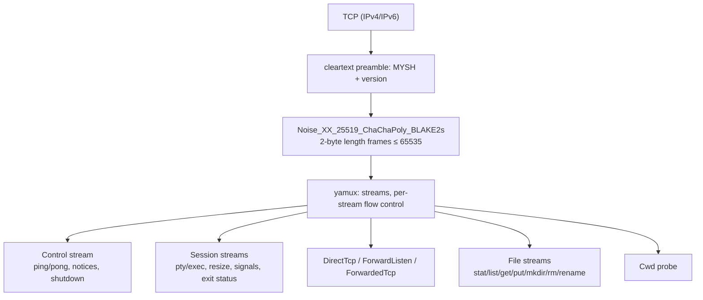

# 01 — Architecture

mysh is a minimal, encrypted remote shell for administering personal servers
and devices. It replaces `ssh` for one operator and a fleet they own; it is
not an SSH implementation and does not aim at multi-tenant hosts.

## Goals

- Mutual authentication and encryption always on; no plaintext or
  unauthenticated mode exists.
- Zero-config **baked** binaries: identity and trusted peers compiled in, no
  files on disk.
- Reuse of existing OpenSSH ed25519 keys, `authorized_keys`, and
  `known_hosts` where that is cheap and sound.
- Interactive PTY sessions that track the client terminal size.
- A **meta shell** inside a session for file transfer, port forwarding, and
  connection introspection, plus the same commands as CLI subcommands.
- One static binary per platform: Linux (musl), macOS, Android. Client and
  server are the same binary.
- Small enough to read in an afternoon. Boring dependencies.

## Non-goals (v1)

- Multi-user login. The server serves exactly one OS user: whoever ran
  `mysh serve`. No PAM, no privilege separation, no `utmp`/`wtmp`, no
  `~user` switching. (Runs fine as root under systemd/launchd if that is the
  intended user.)
- SSH wire compatibility, `scp`/`sftp` compatibility, X11/agent forwarding.
- ssh-agent and hardware-backed keys (see tradeoff in 02-security.md).
- Windows.
- Post-quantum key exchange, session persistence across disconnects,
  connection multiplexing between client processes (roadmap, 06).

## Deployment modes

| Mode       | Identity                    | Trust                              | Use                                   |
| ---------- | --------------------------- | ---------------------------------- | ------------------------------------- |
| configured | `~/.config/mysh/` key files | `authorized_keys`, `known_hosts`   | daily driver                          |
| baked      | compiled-in                 | compiled-in peers                  | rescue media, adb-pushed binaries     |
| mixed      | baked defaults              | baked peers ∪ files                | fleet binary that also accepts admins |

Mode is a property of the build (`--features baked`) plus the presence of
files; the code paths are identical. `--baked-only` ignores files at runtime.

## Process model

One binary, `mysh`:

```
mysh [opts] HOST [CMD...]       client: interactive session or remote exec
mysh serve [opts]               server
mysh keygen | fingerprint       key utilities
mysh put|get|forward|authorize HOST ...   one-shot meta commands
```

Server: a single tokio multi-thread runtime; one task per connection, one per
stream. No `fork()` except the PTY/exec child, spawned via
`tokio::process::Command` with a `pre_exec` hook. No threads besides tokio's.

Client: same runtime; stdin reader, stdout writer, signal listener, and one
task per forwarded connection.

## Layering



Every stream begins with an `Open` message naming its kind; after an
`OpenReply::Ok` the stream is either raw bytes (TCP forwards, file bodies) or
length-prefixed postcard messages (sessions, control). Details in
03-protocol.md.

## Crates

```
crates/
  mysh-proto   wire constants + serde/postcard message types. No I/O. #![forbid(unsafe_code)]
  mysh-net     preamble, Noise handshake, NoiseStream (AsyncRead/Write), yamux,
               key files, ssh key conversion, authorized_keys/known_hosts. #![forbid(unsafe_code)]
  mysh-pty     platform layer: openpty, spawn with controlling tty, winsize,
               termios raw mode, signal plumbing, cwd-of-pid. Only crate with unsafe.
  mysh         bin: cli, client (terminal driver, meta shell, forwards),
               server (sessions, files, forwards), config, baked keys (build.rs)
```

Dependency direction: `mysh → {mysh-net, mysh-pty} → mysh-proto`. All
`cfg(target_os = …)` lives in `mysh-pty` and in `mysh::config` (default
paths), nowhere else.

Planned module layout inside `crates/mysh`:

```
src/
  main.rs          entry; tracing init; dispatch
  cli.rs           clap definitions (05-meta-shell.md "CLI")
  config.rs        paths, HOST parsing, identity/trust resolution order
  client/
    mod.rs         connect: dial, preamble, handshake, trust check, yamux
    terminal.rs    raw mode, SIGWINCH/SIGTSTP, escape-char state machine
    session.rs     pty/exec session driver, exit code mapping
    meta.rs        meta shell: tokenizer, dispatcher, commands
    forward.rs     -L/-R/-D listeners, SOCKS5
    files.rs       put/get/ls with progress
  server/
    mod.rs         listen loop, per-connection accept, authorization
    session.rs     pty + exec sessions
    forward.rs     DirectTcp dial, ForwardListen bind
    files.rs       file service
```

## Dependencies and why

| crate                          | role                                   | note                                                      |
| ------------------------------ | -------------------------------------- | --------------------------------------------------------- |
| `tokio`                        | runtime, net, process, signals         | multi-thread runtime; `process` reaps children            |
| `snow`                         | Noise handshake + transport            | pure Rust (RustCrypto resolver), `default-features = false` — its `std` feature drags in `ring`; cross-compiles with no C toolchain |
| `yamux` + `tokio-util/compat`  | stream multiplexing, flow control      | libp2p's; `futures-io` traits bridged to tokio             |
| `postcard` + `serde`           | message encoding                       | compact, varint, append-only-compatible enums              |
| `ssh-key`                      | OpenSSH key/authorized_keys/known_hosts parsing | `encryption` feature for passphrase-protected keys |
| `curve25519-dalek`, `sha2`     | ed25519 → X25519 conversion, fingerprints | same majors as `snow`/`ssh-key`                          |
| `rustix`                       | pty, termios, ioctls, process          | one API for Linux/macOS/Android; no `nix`                  |
| `libc` (macOS only)            | `proc_pidinfo` for cwd probe           |                                                            |
| `clap`                         | CLI                                    | derive                                                     |
| `shlex`                        | meta shell tokenizer                   |                                                            |
| `indicatif`                    | transfer progress bars                 |                                                            |
| `rpassword`                    | passphrase and TOFU prompts            |                                                            |
| `dirs`                         | XDG / platform directories             |                                                            |
| `tracing`                      | logging                                | `-v` raises level; never logs key material                 |
| `zeroize`                      | secret wiping                          |                                                            |
| `anyhow` / `thiserror`         | errors in bin / libs                   |                                                            |

Not used, deliberately: `rustls`/TLS (PKI-shaped), `russh` (we are replacing
ssh, not reimplementing it), `crossterm` (too much for raw mode + winsize),
`nix` (rustix covers it), `openssl`.

## Platform matrix

|                 | Linux                              | macOS                          | Android                                                |
| --------------- | ---------------------------------- | ------------------------------ | ------------------------------------------------------ |
| client          | yes                                | yes                            | Termux                                                 |
| server          | yes                                | yes                            | Termux, `adb shell` (shell uid), rooted                |
| targets         | `{x86_64,aarch64}-unknown-linux-musl` (static) | `{aarch64,x86_64}-apple-darwin` | `aarch64-linux-android` (+`armv7`, `x86_64` for emulators) |
| pty open        | `posix_openpt`/`/dev/ptmx`         | same                           | same (bionic); needs `devpts`, present in Termux/adb   |
| cwd probe       | `/proc/<pid>/cwd`                  | `proc_pidinfo(PROC_PIDVNODEPATHINFO)` | `/proc/<pid>/cwd` (may be denied cross-uid; same uid is fine) |
| shell detection | `--shell` → `$SHELL` → passwd → `/bin/sh` | same                   | `--shell` → `$SHELL` → `/system/bin/sh`                |
| home            | `$HOME` → passwd → `/`             | same                           | `$HOME` → `/data/local/tmp` → `/`                      |
| config dir      | `$XDG_CONFIG_HOME/mysh` → `~/.config/mysh` | `~/.config/mysh` (not `~/Library`, keep one path) | `~/.config/mysh` under Termux `$HOME`    |
| run as service  | systemd unit (`contrib/`)          | launchd plist (`contrib/`)     | Termux:Boot script; or `adb shell nohup ... &`         |
| notes           | `getpwuid` via libc                | SIP irrelevant; no sandbox     | PIE required (Rust default); no `getpwnam` data; SELinux may block `/proc` of other uids |

## Build

```sh
cargo build --release                                    # native
cargo build --release --target aarch64-unknown-linux-musl   # static linux (needs musl linker, or use cross)
cross build --release --target aarch64-linux-android     # android via docker NDK image
cargo ndk -t arm64-v8a build --release                   # android via local NDK
MYSH_BAKED_IDENTITY=fleet.secret MYSH_BAKED_PEERS=fleet.pub \
  cargo build --release --features baked                 # baked
cargo check-matrix                                       # type-check every target, no linkers needed
cargo lint                                               # clippy -D warnings
```

Release artifacts are the five `mysh` binaries above, built by a release
workflow (06-roadmap.md M4). Android binaries are pushed with
`adb push target/aarch64-linux-android/release/mysh /data/local/tmp/`.

## Repository conventions

- `rust-toolchain.toml` pins the compiler; bump it with `rust-version`.
- Workspace lints: `clippy::pedantic` as warnings, CI runs with
  `-D warnings`. Unsafe only in `mysh-pty`, each block with a `// SAFETY:`
  comment.
- `cargo deny` gates licenses/advisories in CI.
- Docs in `docs/` are the spec; code comments point at them rather than
  restating them. Keep `CHANGELOG.md` current.
