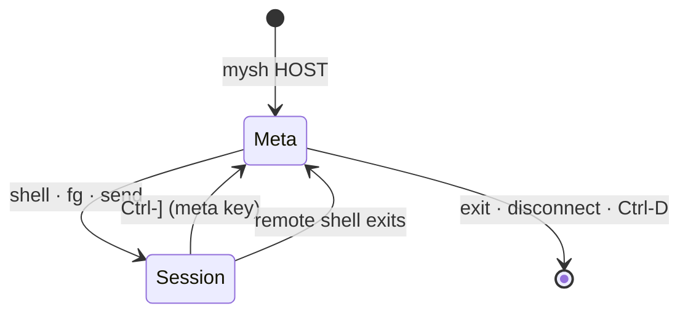

# 05 — Meta shell and CLI

The meta shell is where a mysh connection starts and where it returns to.
`mysh HOST` connects and shows the `mysh HOST> ` prompt; `shell` drops into
a real remote shell; the **meta key** (`Ctrl-]`) brings you back to the
prompt at any time without touching the connection or the shell you left.



One dispatcher (`mysh::client::meta`) serves three frontends: the
interactive prompt; CLI subcommands (`mysh put HOST …`) that connect, run one
command and exit; and a control socket so a CLI subcommand in another
terminal reuses a live interactive connection ("Control socket").

## Meta key

While a session is in the foreground the client intercepts exactly one byte,
the meta key, default `Ctrl-]` (0x1D, the telnet convention). Everything
else — including `~`, `Ctrl-C`, `Ctrl-Z`, `Ctrl-D` — goes to the remote
verbatim. Pressing the meta key moves the session to the background and
shows the meta prompt; nothing is sent to the remote.

- `-e KEY` changes it: a single character or caret notation (`-e '^^'`,
  `-e '^\'`); `-e none` disables interception entirely (binary protocols,
  or when you want the remote to see every byte; `exit`ing the remote shell
  is then the only way back to the prompt).
- To deliver a literal meta key to the remote (vim's `Ctrl-]` tag jump),
  use `send '^]'` from the prompt, or rebind.
- At the prompt the same key is bound to `fg`, so `Ctrl-]` toggles between
  the prompt and the most recently used session.
- No timers, no line-start rule, no second byte: the interception is a
  single-byte match, implemented in `client::terminal` and unit-tested
  against split reads (the byte arriving alone or inside a larger chunk).

The old ssh-style `~` sequences do not exist; `~.` is `disconnect`, `~^Z`
is `Ctrl-Z` at the prompt, `~?` is `help`.

## The prompt

- `mysh HOST> ` on the same terminal (HOST as typed, or the alias name). A
  small built-in line editor (`client::editor`) with history
  (`~/.local/state/mysh/history`, last 1000 lines) and the usual keys:
  printable insert, Backspace/Delete, Left/Right, Home/End, `Ctrl-A/E`,
  `Ctrl-U/K/W`, Up/Down history, `Ctrl-L` redraw. The terminal stays in raw
  mode throughout, which is what makes the meta key bindable here; the
  editor handles echo and editing itself since one stdin reader task owns
  stdin for the whole run.
- Tab completes the local path under the cursor (`~` expanded, relative to
  the `lcd` directory) for every argument of `put`, `lcd`, `log` and
  `authorize`, and for `get` arguments after the first (the local
  destination); everything else is left alone. One match completes it
  (directories get a `/`); several complete the common prefix and a second
  Tab lists them in columns above the redrawn prompt. Dot files are offered
  only when the name starts with `.`.
- `Ctrl-R` searches history backwards incrementally: the prompt becomes
  `(reverse-i-search)'query': match`, typing refines (Backspace shortens the
  query), `Ctrl-R` again moves to the next older match (`failed` appears in
  the prompt when there is none), Enter runs the match, `Esc` or `Ctrl-G`
  restores the line you were editing, and any other editing key keeps the
  match in the line and applies the key.
- On connect, one line: `connected to HOST (SHA256:…, trusted via
  known_hosts); type "shell" for a shell, "help" for commands` — `-q`
  silences it.
- `Ctrl-C` cancels the running command (a `put`, an `exec`) or clears the
  line; it never reaches a remote session from here.
- `Ctrl-Z` suspends the client (04-sessions.md); on `SIGCONT` the prompt is
  redrawn.
- `Ctrl-D` on an empty line is `exit`.
- Tokenizer: POSIX-like quoting via `shlex` (`put "my file.txt"`). Local
  paths get `~` expansion on the client; remote paths on the server. A
  final `&` token runs the command as a background job ("Background jobs").
- Commands run on the live connection as new yamux streams; sessions are
  never disturbed by them.
- Every command has `-h`; `help` lists them. Each command is a small `clap`
  parser so CLI subcommands and prompt commands share one definition.
- Notices (a background session exited, a forward failed) are printed above
  the prompt as they happen, prefixed `[mysh]`.

## Commands (v1)

| command      | synopsis                                                        | notes                                                                 |
| ------------ | --------------------------------------------------------------- | --------------------------------------------------------------------- |
| `help`       | `help [CMD]`                                                    |                                                                       |
| `shell`      | `shell [--home] [CMD...]`                                       | start a new interactive PTY session and bring it to the foreground: the server's login shell (`--shell` → `$SHELL` → passwd → `/bin/sh`), or `CMD` under a PTY (`shell htop`, `shell bash --norc`). Starts in the cwd of the most recently used session, if any, unless `--home`. See "Session stack" |
| `fg`         | `fg [ID]`                                                       | bring session ID (default: most recently used) to the foreground, replaying its buffered output. Also bound to the meta key at the prompt |
| `sessions`   | `sessions [-a]`                                                 | list sessions: id, pid, kind, buffered bytes; `*` marks the most recently used. `-a` also asks the server (`ListSessions`) and prints its view: sessions detached from this or an earlier connection with their age and buffered output, and attached ones |
| `attach`     | `attach [ID]`                                                   | reattach a session detached on the server (same key) and foreground it; replays what it printed while detached. Without ID: the only detached session, else the list is printed and nothing happens. See "Session persistence" |
| `detach`     | `detach [ID]`                                                   | leave session ID (default: most recently used) running on the server and drop it from the stack: the stream is half-closed without a signal; prints `[mysh] session N detached; reattach with: mysh --attach=N HOST`. Refused when the server keeps no sessions (`--detach-grace 0`), since it would hang the session up |
| `kill`       | `kill [-s SIG] ID` · `kill %ID`                                 | `SessionIn::Signal` to session ID (default `TERM`); `%ID` cancels background job ID |
| `send`       | `send TEXT...`                                                  | write TEXT to the most recently used session and foreground it; caret notation (`^]`, `^C`) and `\xNN` are decoded |
| `put`        | `put [-r] [-c] [-P] [-F] [-j N] LOCAL... [REMOTE]`              | default REMOTE = cwd of the MRU session (probe) → `~`; progress bar. `-P` preserves mode/mtime, `-F` follows symlinks (`-p`/`-L` are taken by the shared CLI options); `-r` uploads `-j` files at a time (default 4) with one aggregate progress line |
| `get`        | `get [-r] [-c] [-P] [-j N] REMOTE... [LOCAL]`                   | default LOCAL = client cwd; `-P` preserves mode/mtime; `-r`/`-j` as for `put` |
| `ls`         | `ls [-l] [-a] [REMOTE]`                                         | remote listing; default = MRU session cwd → `~`                        |
| `cwd`        | `cwd`                                                           | print remote cwd (probe source: fg process / shell / home fallback) and local cwd |
| `lcd`        | `lcd [DIR]`                                                     | change the client's working directory used by the prompt               |
| `forward`    | `forward -L SPEC` · `-R SPEC` · `-D SPEC` · `forward ls` · `forward rm ID` | same SPEC grammar as the CLI flags; ids are stable per connection |
| `exec`       | `exec CMD...`                                                   | run a non-PTY exec session; stream output into the prompt; print the exit code. Quick checks without opening a shell |
| `info`       | `info`                                                          | server name, address, protocol version, peer fingerprint + how it was trusted, cipher, uptime, bytes in/out, RTT, sessions, active forwards |
| `ping`       | `ping [-c N]`                                                   | control-stream pings, RTT min/avg/max                                  |
| `resize`     | `resize`                                                        | re-send the current terminal size to the MRU session                   |
| `log`        | `log FILE` · `log off`                                          | tee everything written to the terminal (whichever session is foreground, replays included) to FILE from now on (`script`-like) |
| `authorize`  | `authorize [PUBKEY_FILE]`                                       | append the client's public key (default: the identity in use) to the server's `~/.config/mysh/authorized_keys` via `File` ops; creates the dir `0700`; skips if already present. Equivalent of `ssh-copy-id` |
| `jobs`       | `jobs [-w] [ID]`                                                | list background jobs (`CMD &`); `jobs ID` shows one job's state and captured output; `-w` waits for it first. See "Background jobs" |
| `exit`       | `exit` / `Ctrl-D`                                               | close the connection if no session is running; otherwise refuse and list them (`fg`, `detach`, or `disconnect`) |
| `disconnect` | `disconnect`                                                    | close the connection now. PTY sessions are **not** killed: the server keeps them for its detach grace window (default 10 min) and `mysh --attach HOST` gets them back; with `--detach-grace 0` they get `SIGHUP` from their pty as before. `kill ID` is how you end one |

Output formats are plain text, one record per line, suitable for eyes; there
is no machine-readable mode in v1.

## Session stack

A connection carries any number of PTY sessions (03-protocol.md §7); the
client keeps them in a most-recently-used (MRU) list and gives the terminal
to at most one at a time, the **foreground** session. When none is
foreground, the prompt is.

- `shell [--home] [CMD...]` opens `Open::Session` with `pty` set from the
  current `TERM` and window size, `cwd` = the probed cwd of the MRU session
  (none → server home; `--home` forces home), and `kind: Shell` (server
  shell resolution, 04-sessions.md; login shell) or `Exec { argv: CMD }`
  under a PTY — a single argument goes through `$SHELL -c` exactly like a
  remote command on the CLI. On `Started` the new session becomes
  foreground. Fails with a message if `--deny pty` is set or stdin is not a
  terminal.
- **Background sessions keep running.** Every session has its own reader
  task. Foreground output goes to the terminal; background output goes into
  a per-session 1 MiB ring buffer (oldest bytes dropped). Remote processes
  are never stalled by where the client's focus is.
- **Switching** to a session (`fg`, `send`, the meta key at the prompt)
  replays the ring to the terminal, prints a notice if bytes were dropped,
  then sends `Resize` with the current size so full-screen programs redraw.
- Stdin and `SIGWINCH` go to the foreground session only; a background
  session learns the current size when it next comes to the foreground.
- The meta key works in every foreground session; `shell` from the prompt
  always starts a new one, so you can hold several and `fg` between them.
- **When a session exits:** `[mysh] session N exited: STATUS` is printed
  and the session is removed. If it was foreground, the prompt returns (no
  automatic switch to another session). In auto-exit mode (below) the client
  exits instead when the list becomes empty.
- Sessions are not re-foregrounded on `exit`; `exit` refuses while any
  session is running so that a stray `Ctrl-D` cannot kill three shells.

`sessions` output:

```
  ID  PID    KIND            BUFFERED
* 1   4242   shell           -
  2   4310   exec: htop      12.3 KiB
```

mysh is not a terminal multiplexer: it does not emulate the terminal, so
switching between two full-screen programs can leave the terminal in the
mode of the previous one (alternate screen, mouse reporting, bracketed
paste). The `Resize` redraw covers the common cases; `Ctrl-L` or `reset`
covers the rest. Sessions outlive the connection on servers that keep
detached sessions (below); otherwise they live exactly as long as it.

## Session persistence

The server keeps a PTY session whose client went away (connection lost,
`disconnect`, or `detach`) for `--detach-grace` seconds (default 600; 0 =
off, advertised to clients through `caps::PERSIST`). While detached the
server drains the session's output into a 1 MiB ring; the process never
blocks on a full pty. Reattaching replays the ring, then it is a normal
session (04-sessions.md "Client gone", 03-protocol.md §10bis). This is the
`dtach` model, not a terminal multiplexer: no screen state is kept, so a
full-screen program needs the `Resize`-triggered redraw (sent right after
`Attached`) or `Ctrl-L`.

- `mysh --attach HOST` connects, lists, and foregrounds the only detached
  session; with several, it prints them and exits 1 unless `--attach=ID`
  names one; with none, "no detached sessions" and exit 1. The attached
  session is the primary: the client auto-exits when it ends with its
  status, exactly like `-s`. Needs a terminal. If the server keeps no
  sessions the client says so and exits 2.
- `attach [ID]` at the prompt follows the same rules and lands the session
  in the stack, foregrounded. `detach [ID]` is the inverse. `sessions -a`
  shows the server's list.
- Detached sessions belong to the **client key**: another key cannot see or
  attach them. Session ids are server-wide (one counter per server), which
  is what makes `--attach=ID` meaningful across connections.
- A session attached by one connection cannot be attached by another
  (`attached by another connection`); `detach` it there first, or wait for
  that connection to go away.
- When the process exits while detached the entry stays listed until the
  window ends, and attaching it replays the ring and reports `Exited`.
- `detach` drops the client-side ring for that session; what the session
  prints from then on is what the server replays.

## Modes and exit

| invocation                  | start state                              | client exits when                                   | exit code                      |
| --------------------------- | ---------------------------------------- | --------------------------------------------------- | ------------------------------ |
| `mysh HOST`                 | prompt                                   | `exit`/`Ctrl-D` with no sessions, or `disconnect`   | 0 (255 if the connection drops) |
| `mysh -s HOST`              | `shell` run immediately (ssh feel)       | **auto-exit**: the session list becomes empty       | status of that first shell     |
| `mysh --attach[=ID] HOST`   | the detached session foregrounded (replay first) | **auto-exit**: the session list becomes empty | status of that session (1 if nothing or several to attach, 2 if the server keeps none) |
| `mysh HOST CMD...`          | exec session, no prompt (`-t` for a PTY) | the command exits                                   | its status                     |
| `mysh -N HOST` / `mysh forward` | nothing; stdin untouched             | `Ctrl-C`/`SIGTERM`, or the connection drops         | 0 / 255                        |
| `mysh HOST < script`        | prompt commands read from stdin, no prompt, stop at first failure | stdin EOF or a failing command | 0 / 1 (255 on drop)           |

Auto-exit mode still has the prompt: the meta key works, `shell` can open
more sessions, and the client exits once the last of them is gone. The
primary session's status (the first `shell`, or `CMD`) is remembered for the
exit code if other sessions outlive it (04-sessions.md).

`mysh HOST CMD...` never shows the prompt and never reads the meta key unless
`-t` is given; it is the scriptable path and behaves like `ssh HOST CMD`.

## CLI

```
mysh [OPTIONS] HOST                     connect, land at the prompt
mysh [OPTIONS] -s HOST                  connect and `shell` immediately; exit when the last session ends
mysh [OPTIONS] --attach[=ID] HOST       connect and reattach a detached session; exit when it ends
mysh [OPTIONS] HOST [--] CMD ...        run CMD remotely (no prompt), exit with its status
mysh connect [OPTIONS] HOST [CMD ...]   same as the above; escape hatch when HOST collides with a subcommand name
mysh serve [OPTIONS]
mysh keygen [-o PATH] [-C COMMENT]
mysh fingerprint [FILE]                 key file (private or public, either format); `-` for stdin
mysh put    [OPTIONS] HOST LOCAL... [REMOTE]
mysh get    [OPTIONS] HOST REMOTE... [LOCAL]
mysh forward [OPTIONS] HOST (-L|-R|-D SPEC)...     = connect -N with forwards
mysh authorize [OPTIONS] HOST [PUBKEY_FILE]
```

Subcommand names are reserved words that cannot be used as bare `HOST`; use
`mysh connect NAME` for a host literally named `serve`.

Connection options (shared by every HOST-taking command):

| option                | meaning                                                   |
| --------------------- | --------------------------------------------------------- |
| `-p PORT`             | port (default 7722, or from `HOST:PORT`)                  |
| `-i PATH`             | identity file (02-security.md order)                      |
| `--pin KEY`           | expected server key or fingerprint                        |
| `--accept-new` / `--strict` | TOFU policy                                         |
| `-s`                  | run `shell` on connect; auto-exit when the last session ends |
| `--attach[=ID]`       | reattach a detached session instead (the only one, or ID); auto-exit when it ends |
| `-t` / `-T`           | force / forbid a PTY for `CMD`                            |
| `-N`                  | no session and no stdin; forwards only (safe to run with `&`) |
| `-L/-R/-D SPEC`       | forwards, repeatable                                      |
| `-e KEY|none`         | meta key (default `^]`)                                   |
| `-q`                  | no connect banner                                         |
| `--env NAME[=VALUE]`  | send an environment variable (server must accept it)      |
| `--baked-only`        | ignore files on disk                                      |
| `--no-ctl`            | never use or serve the control socket (below)             |
| `-v`                  | repeatable; `-vv` includes handshake and stream events    |

`HOST` forms: `host`, `host:port`, `[v6addr]:port`, `v6addr` (bare), or a
config alias (below).

Server options:

| option                              | meaning                                                   |
| ----------------------------------- | --------------------------------------------------------- |
| `--listen ADDR`                     | repeatable; default `[::]:7722` (dual-stack) with fallback to `0.0.0.0:7722` |
| `--key PATH`, `--no-generate-key`   | identity                                                  |
| `--authorized-keys PATH`, `--authorized-key KEY`, `--no-ssh-authorized-keys` | trust               |
| `--shell PATH`                      | override shell resolution                                 |
| `--accept-env NAME`                 | repeatable; extra env names accepted from clients         |
| `--deny FEATURE`                    | `pty`, `exec`, `files`, `forward-local`, `forward-remote` |
| `--name NAME`                       | name sent in `ServerHello` (default hostname)             |
| `--handshake-rate N`                | handshakes per minute per client address (default 10; 0 = off) |
| `--idle-timeout SECS`               | close a connection with no control traffic (default 120)  |
| `--detach-grace SECS`               | keep a detached PTY session this long (default 600)       |
| `--no-signature-auth`               | do not accept ssh-ed25519 signature authentication        |
| `--baked-only`                      | ignore files on disk                                      |
| `-v`                                | log level                                                 |

Signals: `SIGTERM`/`SIGINT` → send `Shutdown` on every connection, wait up
to 5 s for sessions to end, hang up detached sessions, exit. `SIGHUP` is
ignored (files are re-read per connection anyway).

## Config file (v1, minimal)

`~/.config/mysh/config.toml`, optional:

```toml
[defaults]
escape = "^]"          # meta key
shell = false          # true = behave like `-s` everywhere

[hosts.pi]
host = "pi.lan"
port = 7722
identity = "~/.ssh/id_ed25519"
pin = "SHA256:…"
forward = ["-L 8080:localhost:80"]
env = ["LANG"]
shell = true           # `mysh pi` goes straight to a shell
```

Flags override the alias; the alias overrides `[defaults]`; `[defaults]`
overrides built-ins. No `Match` blocks, no includes.

## Control socket

An interactive client (prompt mode on a terminal) listens on a unix socket
so that `mysh put/get/forward/authorize HOST …` from another terminal reuse
its live connection instead of opening a new one: no second handshake, no
second TOFU prompt, nothing counted by the server's handshake rate limit.

- Path: `$XDG_RUNTIME_DIR/mysh/<host>_<port>.sock`, falling back to
  `$XDG_CACHE_HOME/mysh/` then `~/.cache/mysh/` (`Paths.runtime_dir`). The
  directory is created `0700`, the socket `0600`. `<host>` is the resolved
  target host with every character outside `[A-Za-z0-9.-]` replaced by `_`
  (`[fe80::1]:7000` → `fe80__1_7000.sock`). The target, not the server
  fingerprint, keys the socket: a CLI subcommand knows the target before it
  connects, but learns the fingerprint only by connecting.
- Lifetime: created after the connect banner, removed when the prompt
  exits. A socket file that no longer accepts connections is stale and is
  replaced; one that does belongs to another client for the same target,
  and the new client prints a notice and runs without a socket.
- Protocol, one request per connection: the requester writes one
  `Msg<CtlRequest { argv: Vec<String>, cwd: String }>` (the prompt words,
  and its working directory for local paths); the serving client replies
  with a stream of `Msg<CtlEvent>` — `Out(bytes)`, `Err(bytes)`,
  `Progress { label, done, total }` — ending with `Done { code }`. Both use
  `mysh_proto::frame` framing (`client::ctl`).
- Allowed over the socket: `put get ls cwd forward exec info ping sessions
  kill jobs authorize help`. Refused with an error event: `shell fg send
  resize log exit disconnect attach detach` (they need the serving client's
  terminal) and `lcd` (the request carries its own cwd). A trailing `&` is
  refused too.
- The serving client runs each request on its own task with a capture
  console, concurrently with the prompt, and prints `[mysh] ctl: put …`
  above it. `sessions`/`kill`/`cwd`/`info` see the prompt's sessions; an
  `exec` runs in a private session that ends with the request (if the
  requester hangs up mid-way the request is cancelled and the session gets
  `SIGTERM`).
- CLI side: `mysh put|get|forward|authorize HOST …` first tries the socket
  for the resolved target; the reply is streamed to the local stdout/stderr
  (progress drawn locally) and the process exits with `code`. No usable
  socket → today's path (a fresh connection). `--no-ctl` skips the socket on
  both sides: a CLI command always connects, an interactive client never
  listens. `mysh forward HOST -L …` over the socket adds the forwards to the
  live client and returns at once.

## Background jobs

A prompt line ending in a lone `&` token runs as a job: `put big.iso ~/ &`.
The prompt returns immediately with `[N] started`; the job runs with a
capture console, so nothing it prints interleaves with the prompt. Only
`put`, `get`, `ls`, `exec` and `authorize` can be backgrounded (the rest
need the terminal); `&` alone is an error, and an `&` glued to a word
(`put a&`) is part of that word (the tokenizer only strips a final `&`
token).

- `jobs` lists them: id (from 1), state (`running` or the last progress
  percentage, `done`, `exit N`, `failed`, `cancelled`), elapsed time, and the
  command line.
- `jobs ID` prints the job's state and its captured output (stdout and
  stderr interleaved, the last 64 KiB).
- `jobs -w ID` waits for the job to finish, then prints the same.
- `kill %ID` cancels a running job (the task is aborted; an `exec` job's
  session gets `SIGTERM`).
- Completion is announced above the prompt — `[mysh] job 3 done: put
  big.iso ~/ (2.9 MiB, 1.2 s)` — followed by the captured output.
- In scripted mode (`mysh HOST < script`) `&` works the same; at end of
  input the script waits for its jobs and exits 1 if any failed.
