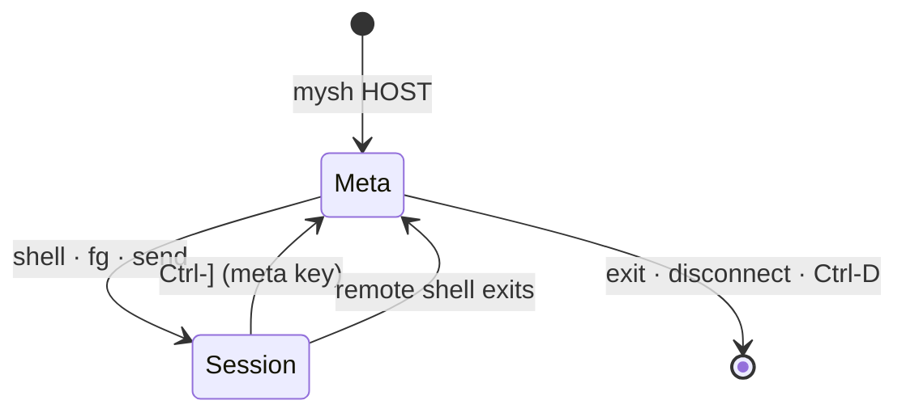

# 05 — Meta shell and CLI

The meta shell is where a mysh connection starts and where it returns to.
`mysh HOST` connects and shows the `mysh HOST> ` prompt; `shell` drops into
a real remote shell; the **meta key** (`Ctrl-]`) brings you back to the
prompt at any time without touching the connection or the shell you left.



One dispatcher (`mysh::client::meta`) serves three frontends: the
interactive prompt; CLI subcommands (`mysh put HOST …`) that connect, run one
command and exit; and a control socket so a CLI subcommand in another
terminal reuses a live interactive connection ("Control socket").

## Meta key

While a session is in the foreground the client intercepts exactly one byte,
the meta key, default `Ctrl-]` (0x1D, the telnet convention). Everything
else — including `~`, `Ctrl-C`, `Ctrl-Z`, `Ctrl-D` — goes to the remote
verbatim. Pressing the meta key moves the session to the background and
shows the meta prompt; nothing is sent to the remote.

- `-e KEY` changes it: a single character or caret notation (`-e '^^'`,
  `-e '^\'`); `-e none` disables interception entirely (binary protocols,
  or when you want the remote to see every byte; `exit`ing the remote shell
  is then the only way back to the prompt).
- To deliver a literal meta key to the remote (vim's `Ctrl-]` tag jump),
  use `send '^]'` from the prompt, or rebind.
- At the prompt the same key is bound to `fg`, so `Ctrl-]` toggles between
  the prompt and the most recently used session.
- No timers, no line-start rule, no second byte: the interception is a
  single-byte match, implemented in `client::terminal` and unit-tested
  against split reads (the byte arriving alone or inside a larger chunk).

The old ssh-style `~` sequences do not exist; `~.` is `disconnect`, `~^Z`
is `Ctrl-Z` at the prompt, `~?` is `help`.

## The prompt

- `mysh HOST> ` on the same terminal (HOST as typed, or the alias name). A
  small built-in line editor (`client::editor`) with history
  (`~/.local/state/mysh/history`, last 1000 lines) and the usual keys:
  printable insert, Backspace/Delete, Left/Right, Home/End, `Ctrl-A/E`,
  `Ctrl-U/K/W`, Up/Down history, `Ctrl-L` redraw. The terminal stays in raw
  mode throughout, which is what makes the meta key bindable here; the
  editor handles echo and editing itself since one stdin reader task owns
  stdin for the whole run.
- Tab completes the local path under the cursor (`~` expanded, relative to
  the `lcd` directory) for every argument of `put`, `lcd`, `log` and
  `authorize`, and for `get` arguments after the first (the local
  destination); everything else is left alone. One match completes it
  (directories get a `/`); several complete the common prefix and a second
  Tab lists them in columns above the redrawn prompt. Dot files are offered
  only when the name starts with `.`.
- `Ctrl-R` searches history backwards incrementally: the prompt becomes
  `(reverse-i-search)'query': match`, typing refines (Backspace shortens the
  query), `Ctrl-R` again moves to the next older match (`failed` appears in
  the prompt when there is none), Enter runs the match, `Esc` or `Ctrl-G`
  restores the line you were editing, and any other editing key keeps the
  match in the line and applies the key.
- On connect, one line: `connected to HOST (SHA256:…, trusted via
  known_hosts); type "shell" for a shell, "help" for commands` — `-q`
  silences it.
- `Ctrl-C` cancels the running command (a `put`, an `exec`) or clears the
  line; it never reaches a remote session from here.
- `Ctrl-Z` suspends the client (04-sessions.md); on `SIGCONT` the prompt is
  redrawn.
- `Ctrl-D` on an empty line is `exit`.
- Tokenizer: POSIX-like quoting via `shlex` (`put "my file.txt"`). Local
  paths get `~` expansion on the client; remote paths on the server. A
  final `&` token runs the command as a background job ("Background jobs").
- Commands run on the live connection as new yamux streams; sessions are
  never disturbed by them.
- Every command has `-h`; `help` lists them. Each command is a small `clap`
  parser so CLI subcommands and prompt commands share one definition.
- Notices (a background session exited, a forward failed) are printed above
  the prompt as they happen, prefixed `[mysh]`.

## Commands (v1)

| command      | synopsis                                                        | notes                                                                 |
| ------------ | --------------------------------------------------------------- | --------------------------------------------------------------------- |
| `help`       | `help [--json] [CMD]`                                           | `--json`: the prompt grammar as a command tree (see "Agent interface") |
| `shell`      | `shell [--home] [CMD...]`                                       | start a new interactive PTY session and bring it to the foreground: the server's login shell (`--shell` → `$SHELL` → passwd → `/bin/sh`), or `CMD` under a PTY (`shell htop`, `shell bash --norc`). Starts in the cwd of the most recently used session, if any, unless `--home`. See "Session stack" |
| `fg`         | `fg [ID]`                                                       | bring session ID (default: most recently used) to the foreground, replaying its buffered output. Also bound to the meta key at the prompt |
| `sessions`   | `sessions [-a]`                                                 | list sessions: id, pid, kind, buffered bytes; `*` marks the most recently used. `-a` also asks the server (`ListSessions`) and prints its view: sessions detached from this or an earlier connection with their age and buffered output, and attached ones |
| `attach`     | `attach [ID]`                                                   | reattach a session detached on the server (same key) and foreground it; replays what it printed while detached. Without ID: the only detached session, else the list is printed and nothing happens. See "Session persistence" |
| `detach`     | `detach [ID]`                                                   | leave session ID (default: most recently used) running on the server and drop it from the stack: the stream is half-closed without a signal; prints `[mysh] session N detached; reattach with: mysh --attach=N HOST`. Refused when the server keeps no sessions (`--detach-grace 0`), since it would hang the session up |
| `kill`       | `kill [-s SIG] ID` · `kill %ID`                                 | `SessionIn::Signal` to session ID (default `TERM`); `%ID` cancels background job ID |
| `send`       | `send TEXT...`                                                  | write TEXT to the most recently used session and foreground it; caret notation (`^]`, `^C`) and `\xNN` are decoded |
| `put`        | `put [-r] [-c] [-P] [-F] [-j N] [--checksum] LOCAL... [REMOTE]` · `put [--mode M] [--mtime T] - REMOTE` | default REMOTE = cwd of the MRU session (probe) → `~`; progress bar. `-P` preserves mode/mtime, `-F` follows symlinks (`-p`/`-L` are taken by the shared CLI options); `-r` uploads `-j` files at a time (default 4) with one aggregate progress line; `--checksum` skips files whose size and BLAKE2s digest already match (counted as `skipped`); `-` streams stdin to EOF into REMOTE (CLI and control socket only — the prompt owns stdin) |
| `get`        | `get [-r] [-c] [-P] [-j N] [--checksum] REMOTE... [LOCAL]`      | default LOCAL = client cwd; `-P` preserves mode/mtime; `-r`/`-j`/`--checksum` as for `put`; LOCAL `-` prints the files to stdout in order (= `cat`) |
| `cat`        | `cat REMOTE...`                                                 | print remote files to stdout, in order; no progress line (stdout is the body) |
| `write`      | `write [--mode M] [--append] REMOTE`                            | stdin to EOF into REMOTE: atomic replace (mode default 0644), or `--append` after a `Stat` (keeps the file's mode). CLI and control socket only |
| `tail`       | `tail [-n N] [-f] [--for D] REMOTE`                             | last N lines (default 10); `-f` keeps printing as the file grows until Ctrl-C, `--for D`, or the connection's `--timeout` — all exit 0 (`--timeout` is the shared CLI option, hence `--for`) |
| `ls`         | `ls [-l] [-a] [REMOTE]`                                         | remote listing; default = MRU session cwd → `~`                        |
| `stat`       | `stat REMOTE...`                                                | each path's attributes: mode, size, mtime, kind, symlink target         |
| `mkdir`      | `mkdir [-P] [-m MODE] REMOTE...`                                | create directories (mode default 0755); `-P` creates missing parents and accepts existing ones (`-p` is the shared port option) |
| `rm`         | `rm [-r] REMOTE...`                                             | remove files; `-r` removes directories with their contents             |
| `mv`         | `mv FROM TO`                                                    | rename a remote path (replaces TO)                                     |
| `realpath`   | `realpath REMOTE`                                               | the canonical remote path (`~`, `..`, symlinks resolved)                |
| `hash`       | `hash REMOTE...`                                                | `blake2s256  <hex>  <size>  <path>` per regular file                   |
| `sync`       | `sync [--pull] [--delete] [--dry-run] [--checksum] [-j N] SRC DST` | mirror a tree: `sync LOCAL REMOTE` pushes, `sync --pull REMOTE LOCAL` pulls (the form gives the direction; no `HOST:` prefix). Plans by size + mtime (±1 s), or by digest with `--checksum`; `--dry-run` prints the plan and changes nothing; `--delete` removes the destination's extras (files, then directories deepest first). See 04-sessions.md "sync" |
| `cwd`        | `cwd`                                                           | print remote cwd (probe source: fg process / shell / home fallback) and local cwd |
| `lcd`        | `lcd [DIR]`                                                     | change the client's working directory used by the prompt               |
| `forward`    | `forward -L SPEC` · `-R SPEC` · `-D SPEC` · `forward ls` · `forward rm ID` | same SPEC grammar as the CLI flags; ids are stable per connection |
| `exec`       | `exec [--timeout D] [--cwd DIR] CMD...`                         | run a non-PTY exec session; stream output into the prompt; print the exit code. Quick checks without opening a shell. `--cwd` sets the start directory (default: MRU session cwd); `--timeout` sends `TERM`, then `KILL` 2 s later, and reports exit 124 |
| `info`       | `info`                                                          | server name, address, protocol version, peer fingerprint + how it was trusted, cipher, uptime, bytes in/out, RTT, sessions, active forwards; then the server's own facts from `Open::Info` (version, platform, kernel, shell, home, user, uptime, limits, denied features) when it answers |
| `ping`       | `ping [-c N]`                                                   | control-stream pings, RTT min/avg/max                                  |
| `bind`       | `bind [ADDR\|off] [--for D]`                                    | ask the server to bind a listener of its own so ordinary clients can dial it (`ADDR` = `host:port` or a bare `PORT`, default `0.0.0.0:7722`); `--for D` closes it after D without a connection, `bind off` closes it now. Refused with `denied` unless the server runs with `--allow-bind-request`. Typical use: `mysh bind @host-a 0.0.0.0:7722 --for 1h` on an accepted connection |
| `resize`     | `resize`                                                        | re-send the current terminal size to the MRU session                   |
| `log`        | `log FILE` · `log off`                                          | tee everything written to the terminal (whichever session is foreground, replays included) to FILE from now on (`script`-like) |
| `authorize`  | `authorize [PUBKEY_FILE]`                                       | append the client's public key (default: the identity in use) to the server's `~/.config/mysh/authorized_keys` via `File` ops; creates the dir `0700`; skips if already present. Equivalent of `ssh-copy-id` |
| `jobs`       | `jobs [-w] [ID]`                                                | list background jobs (`CMD &`); `jobs ID` shows one job's state and captured output; `-w` waits for it first. See "Background jobs" |
| `session`    | `session new|send|read|list|kill|wait …`                        | the remote process API: sessions addressed by id instead of by a terminal. See "Session command family" |
| `exit`       | `exit` / `Ctrl-D`                                               | close the connection if no session is running; otherwise refuse and list them (`fg`, `detach`, or `disconnect`) |
| `disconnect` | `disconnect`                                                    | close the connection now. PTY sessions are **not** killed: the server keeps them for its detach grace window (default 10 min) and `mysh --attach HOST` gets them back; with `--detach-grace 0` they get `SIGHUP` from their pty as before. `kill ID` is how you end one |

Output formats are plain text, one record per line, suitable for eyes.
`--json` / `--json-stream` on the command line switch every command to the
documents and events of the "Agent interface" section below.

## Session stack

A connection carries any number of PTY sessions (03-protocol.md §7); the
client keeps them in a most-recently-used (MRU) list and gives the terminal
to at most one at a time, the **foreground** session. When none is
foreground, the prompt is.

- `shell [--home] [CMD...]` opens `Open::Session` with `pty` set from the
  current `TERM` and window size, `cwd` = the probed cwd of the MRU session
  (none → server home; `--home` forces home), and `kind: Shell` (server
  shell resolution, 04-sessions.md; login shell) or `Exec { argv: CMD }`
  under a PTY — a single argument goes through `$SHELL -c` exactly like a
  remote command on the CLI. On `Started` the new session becomes
  foreground. Fails with a message if `--deny pty` is set or stdin is not a
  terminal.
- **Background sessions keep running.** Every session has its own reader
  task. Foreground output goes to the terminal; background output goes into
  a per-session 1 MiB ring buffer (oldest bytes dropped). Remote processes
  are never stalled by where the client's focus is.
- **Switching** to a session (`fg`, `send`, the meta key at the prompt)
  replays the ring to the terminal, prints a notice if bytes were dropped,
  then sends `Resize` with the current size so full-screen programs redraw.
- Stdin and `SIGWINCH` go to the foreground session only; a background
  session learns the current size when it next comes to the foreground.
- The meta key works in every foreground session; `shell` from the prompt
  always starts a new one, so you can hold several and `fg` between them.
- **When a session exits:** `[mysh] session N exited: STATUS` is printed
  and the session is removed. If it was foreground, the prompt returns (no
  automatic switch to another session). In auto-exit mode (below) the client
  exits instead when the list becomes empty.
- Sessions are not re-foregrounded on `exit`; `exit` refuses while any
  session is running so that a stray `Ctrl-D` cannot kill three shells.

`sessions` output:

```
  ID  PID    KIND            BUFFERED
* 1   4242   shell           -
  2   4310   exec: htop      12.3 KiB
```

mysh is not a terminal multiplexer: it does not emulate the terminal, so
switching between two full-screen programs can leave the terminal in the
mode of the previous one (alternate screen, mouse reporting, bracketed
paste). The `Resize` redraw covers the common cases; `Ctrl-L` or `reset`
covers the rest. Sessions outlive the connection on servers that keep
detached sessions (below); otherwise they live exactly as long as it.

## Session persistence

The server keeps a PTY session whose client went away (connection lost,
`disconnect`, or `detach`) for `--detach-grace` seconds (default 600; 0 =
off, advertised to clients through `caps::PERSIST`). While detached the
server drains the session's output into a 1 MiB ring; the process never
blocks on a full pty. Reattaching replays the ring, then it is a normal
session (04-sessions.md "Client gone", 03-protocol.md §10bis). This is the
`dtach` model, not a terminal multiplexer: no screen state is kept, so a
full-screen program needs the `Resize`-triggered redraw (sent right after
`Attached`) or `Ctrl-L`.

- `mysh --attach HOST` connects, lists, and foregrounds the only detached
  session; with several, it prints them and exits 1 unless `--attach=ID`
  names one; with none, "no detached sessions" and exit 1. The attached
  session is the primary: the client auto-exits when it ends with its
  status, exactly like `-s`. Needs a terminal. If the server keeps no
  sessions the client says so and exits 2.
- `attach [ID]` at the prompt follows the same rules and lands the session
  in the stack, foregrounded. `detach [ID]` is the inverse. `sessions -a`
  shows the server's list.
- Detached sessions belong to the **client key**: another key cannot see or
  attach them. Session ids are server-wide (one counter per server), which
  is what makes `--attach=ID` meaningful across connections.
- A session attached by one connection cannot be attached by another
  (`attached by another connection`); `detach` it there first, or wait for
  that connection to go away.
- When the process exits while detached the entry stays listed until the
  window ends, and attaching it replays the ring and reports `Exited`.
- `detach` drops the client-side ring for that session; what the session
  prints from then on is what the server replays.

## Modes and exit

| invocation                  | start state                              | client exits when                                   | exit code                      |
| --------------------------- | ---------------------------------------- | --------------------------------------------------- | ------------------------------ |
| `mysh HOST`                 | prompt                                   | `exit`/`Ctrl-D` with no sessions, or `disconnect`   | 0 (255 if the connection drops) |
| `mysh -s HOST`              | `shell` run immediately (ssh feel)       | **auto-exit**: the session list becomes empty       | status of that first shell     |
| `mysh --attach[=ID] HOST`   | the detached session foregrounded (replay first) | **auto-exit**: the session list becomes empty | status of that session (1 if nothing or several to attach, 2 if the server keeps none) |
| `mysh HOST CMD...`          | exec session, no prompt (`-t` for a PTY) | the command exits                                   | its status                     |
| `mysh -N HOST` / `mysh forward` | nothing; stdin untouched             | `Ctrl-C`/`SIGTERM`, or the connection drops         | 0 / 255                        |
| `mysh HOST < script`        | prompt commands read from stdin, no prompt, stop at first failure | stdin EOF or a failing command | 0 / 1 (255 on drop; 124 after `--timeout`) |
| `mysh --json HOST [< script]` | scripted mode even on a terminal; one JSON document per command | as above                        | as above                       |

Auto-exit mode still has the prompt: the meta key works, `shell` can open
more sessions, and the client exits once the last of them is gone. The
primary session's status (the first `shell`, or `CMD`) is remembered for the
exit code if other sessions outlive it (04-sessions.md).

`mysh HOST CMD...` never shows the prompt and never reads the meta key unless
`-t` is given; it is the scriptable path and behaves like `ssh HOST CMD`.

## CLI

```
mysh [OPTIONS] HOST                     connect, land at the prompt
mysh [OPTIONS] -s HOST                  connect and `shell` immediately; exit when the last session ends
mysh [OPTIONS] --attach[=ID] HOST       connect and reattach a detached session; exit when it ends
mysh [OPTIONS] HOST [--] CMD ...        run CMD remotely (no prompt), exit with its status
mysh connect [OPTIONS] HOST [CMD ...]   same as the above; escape hatch when HOST collides with a subcommand name
mysh serve [OPTIONS]
mysh keygen [-o PATH] [-C COMMENT]
mysh fingerprint [FILE]                 key file (private or public, either format); `-` for stdin
mysh put    [OPTIONS] HOST LOCAL... [REMOTE]
mysh get    [OPTIONS] HOST REMOTE... [LOCAL]     LOCAL `-` prints to stdout; `put - REMOTE` reads stdin
mysh cat    [OPTIONS] HOST REMOTE...
mysh write  [OPTIONS] HOST [--mode M] [--append] REMOTE     from stdin
mysh tail   [OPTIONS] HOST [-n N] [-f] [--for D] REMOTE
mysh stat   [OPTIONS] HOST REMOTE...
mysh mkdir  [OPTIONS] HOST [-P] [-m MODE] REMOTE...
mysh rm     [OPTIONS] HOST [-r] REMOTE...
mysh mv     [OPTIONS] HOST FROM TO
mysh realpath [OPTIONS] HOST REMOTE
mysh hash   [OPTIONS] HOST REMOTE...
mysh sync   [OPTIONS] HOST [--pull] [--delete] [--dry-run] [--checksum] [-j N] SRC DST
mysh forward [OPTIONS] HOST (-L|-R|-D SPEC)...     = connect -N with forwards
mysh authorize [OPTIONS] HOST [PUBKEY_FILE]
mysh pair [OPTIONS] HOST CODE...        first contact: run the PAKE with the code printed by `serve --pair`; installs our key on HOST and pins HOST's key locally (02-security.md "Pairing"). Exit 2 when the server has no window open or the code is wrong (nothing is written)
mysh accept [ADDR] [--callers PATH] [--accept-new] [--handshakes-per-minute N] [--json]   accept connections servers open themselves ("Accepting connections")
mysh bind [OPTIONS] HOST [ADDR|off] [--for D]   ask HOST to bind a listener for ordinary clients (needs `serve --allow-bind-request`)
mysh help [--json] [CMD]                clap's help for CMD (or the whole CLI); `--json`: the command tree
mysh session [OPTIONS] HOST new [--cwd DIR] [--pty] [--env K=V] -- CMD ...
mysh session [OPTIONS] HOST send ID [TEXT...] [--stdin] [--eof]
mysh session [OPTIONS] HOST read ID [--since N] [--wait D] [--max BYTES] [--follow]
mysh session [OPTIONS] HOST list|kill ID [-s SIG]|wait ID [--timeout D]
mysh master [OPTIONS] HOST [--idle D] [--daemon]   hold the connection open for other calls
mysh run [OPTIONS] [-j N] (--hosts a,b | --group NAME)... -- CMD ...   the same command on several hosts ("Fleet")
mysh put/get [OPTIONS] (--hosts a,b | --group NAME)... PATH...        the same transfer to/from several hosts ("Fleet")
mysh mcp (--hosts a,b | --group NAME)... [--accept-new] [-i PATH] [--allow-local-paths]   MCP server over stdio for agents (07-embedding.md "MCP server")
mysh assets [--json] [--for SPEC] [--dir DIR]   the installed release binaries; `--for "$(uname -sm)"` picks one ("Assets")
mysh skill <install [--to DIR]... | list | show> [--json]   the agent skill: install for the agents on this machine, list, print ("Skill")
```

Subcommand names are reserved words that cannot be used as bare `HOST`; use
`mysh connect NAME` for a host literally named `serve`.

Connection options (shared by every HOST-taking command):

| option                | meaning                                                   |
| --------------------- | --------------------------------------------------------- |
| `-p PORT`             | port (default 7722, or from `HOST:PORT`)                  |
| `-i PATH`             | identity: a private key file, or a `.pub` naming an `ssh-agent` key (02-security.md order; without `-i` the key file is tried first, then agent keys from `$SSH_AUTH_SOCK`) |
| `--pin KEY`           | expected server key or fingerprint                        |
| `--accept-new` / `--strict` | TOFU policy                                         |
| `-s`                  | run `shell` on connect; auto-exit when the last session ends |
| `--attach[=ID]`       | reattach a detached session instead (the only one, or ID); auto-exit when it ends |
| `-t` / `-T`           | force / forbid a PTY for `CMD`                            |
| `-N`                  | no session and no stdin; forwards only (safe to run with `&`) |
| `-L/-R/-D SPEC`       | forwards, repeatable                                      |
| `-e KEY|none`         | meta key (default `^]`)                                   |
| `-q`                  | no connect banner                                         |
| `--env NAME[=VALUE]`  | send an environment variable (server must accept it)      |
| `--baked-only`        | ignore files on disk                                      |
| `--no-ctl`            | never use or serve the control socket (below)             |
| `--json`              | one JSON document per command on stdout, errors as JSON on stderr ("Agent interface") |
| `--json-stream`       | NDJSON events on stdout as they happen                    |
| `--plain`             | no ANSI, progress lines, banner or prompt redraws; implied by the JSON modes and when stdout is not a terminal |
| `--timeout DURATION`  | `10s`, `2m`, `500ms`: bound on `CMD`, `put`, `get`, the file primitives and the prompt's `exec`/`put`/`get` (`TERM`, `KILL` after 2 s, exit 124); for `tail -f` it is the follow's deadline and a clean exit 0 |
| `--cwd DIR`           | working directory for `CMD` (`~`-relative is expanded by the server) |
| `-v`                  | repeatable; `-vv` includes handshake and stream events    |
| `-M`                  | run as a background master for HOST (same as `mysh master HOST`) |
| `--master MODE`       | `never` (default), `auto`, `always`: start a master when no control socket is there |
| `--hosts a,b,…`       | fan out to these hosts (comma-separated, repeatable); `run`, `put`, `get` only ("Fleet") |
| `--group NAME`        | fan out to `[groups.NAME]` of the config file (repeatable, mixes with `--hosts`) |

`HOST` forms: `host`, `host:port`, `[v6addr]:port`, `v6addr` (bare), a
config alias (below), or `@NAME` — an accepted connection
("Accepting connections"), which is reached through its control socket
and never dialed.

Server options:

| option                              | meaning                                                   |
| ----------------------------------- | --------------------------------------------------------- |
| `--listen ADDR`                     | repeatable; default `[::]:7722` (dual-stack) with fallback to `0.0.0.0:7722`. With `--connect-back` and no `--listen`, nothing is bound |
| `--connect-back ADDR`               | repeatable, `host[:port]` (default port 7722): connect back to a client accepting connections (`mysh accept`) and serve it; one connection per address at a time, the next attempt one period after the start of the previous one, failures retried with backoff (5 s doubling, capped at the period) |
| `--connect-period DURATION`         | start-to-start interval of connect-back attempts (default `5m`) |
| `--connect-jitter PERCENT`          | uniform ± spread on each period so many servers do not dial together (default 10) |
| `--connect-max DURATION`            | a connect-back connection the client holds longer than this is closed by the server (`Shutdown`; default `30m`) |
| `--allow-bind-request`              | let authorized clients ask the server to bind a listener (`bind` command, 03-protocol.md §6); default off |
| `--key PATH`, `--no-generate-key`   | identity                                                  |
| `--authorized-keys PATH`, `--authorized-key KEY`, `--no-ssh-authorized-keys` | trust               |
| `--shell PATH`                      | override shell resolution                                 |
| `--accept-env NAME`                 | repeatable; extra env names accepted from clients         |
| `--deny FEATURE`                    | `pty`, `exec`, `files`, `forward-local`, `forward-remote` |
| `--name NAME`                       | name sent in `ServerHello` (default hostname)             |
| `--handshake-rate N`                | handshakes per minute per client address (default 10; 0 = off) |
| `--idle-timeout SECS`               | close a connection with no control traffic (default 120)  |
| `--detach-grace SECS`               | keep a detached PTY session this long (default 600)       |
| `--no-signature-auth`               | do not accept ssh-ed25519 signature authentication (agent keys); clears `caps::SIG_AUTH` |
| `--pair [DURATION]`                 | open a pairing window at start (default `5m`) and print its one-time code to stderr; lets the server start with an empty `authorized_keys`. See 02-security.md "Pairing" |
| `--audit PATH`                      | append one JSON line per audited event to PATH (created 0600; `-` = stderr). See 02-security.md "Audit log" |
| `--baked-only`                      | ignore files on disk                                      |
| `-v`                                | log level                                                 |
| `--daemon`                          | detach: re-run in the background and exit 0 once listening (see "Running without a supervisor") |
| `--log PATH`                        | with `--daemon`: append the log to PATH (default `$XDG_STATE_HOME/mysh/serve.log`) |
| `--pid-file PATH`                   | write the pid once up, remove it at a clean exit; with or without `--daemon` |

Signals: `SIGTERM`/`SIGINT` → send `Shutdown` on every connection, wait up
to 5 s for sessions to end, hang up detached sessions, exit. `SIGHUP` is
ignored (a handler is registered and never acted on, so a closed terminal
does not end a backgrounded server; files are re-read per connection
anyway). `SIGUSR1` → open a new pairing window (5 min, replacing any) and
print its code to stderr.

### Running without a supervisor

`mysh serve --daemon …` and `mysh accept --daemon …` detach: the process
re-executes itself with the same arguments minus `--daemon`, in its own
process group, standard input from `/dev/null`, standard output and error
appended to the `--log` file (created 0600), and the parent waits for the
child to report that it is listening (accepting) before printing
`mysh serve: started, pid N, log PATH` (`{"pid","log"}` with `accept
--json`) and exiting 0. A child that fails first makes the parent exit 1
with the child's log lines, so a script can trust the exit status. There
is no `fork(2)`: `unsafe` stays in `mysh-pty`; the re-exec gives the same
detachment. The child reports through `MYSH_READY_FILE`, a path the parent
sets and removes; it is not inherited by sessions (their environment is
built from scratch). Where a supervisor exists, use it instead — the
`contrib/` units run the foreground form and give restart and logging.

## Config file (v1, minimal)

`~/.config/mysh/config.toml`, optional:

```toml
[defaults]
escape = "^]"          # meta key
shell = false          # true = behave like `-s` everywhere
master = "never"       # "auto" (or true) starts a background master for socket-less calls; "always" requires one

[hosts.box]
host = "box.lan"
port = 7722
identity = "~/.ssh/id_ed25519"
pin = "SHA256:…"
forward = ["-L 8080:localhost:80"]
env = ["LANG"]
shell = true           # `mysh box` goes straight to a shell
master = "auto"        # per-host master policy

[groups.lab]           # `--group lab` ("Fleet")
hosts = ["box", "nas", "10.0.0.5:7722"]

[assets]               # where the release binaries live ("Assets")
dir = "~/.local/share/mysh"
```

Flags override the alias; the alias overrides `[defaults]`; `[defaults]`
overrides built-ins. No `Match` blocks, no includes.

## Fleet

`mysh run` executes one command on several hosts and `put`/`get --hosts`
move the same files to or from several hosts:

```
mysh run [-j N] [--hosts a,b,c] [--group NAME]... [--json] [--timeout D] [--cwd D] -- CMD...
mysh put --hosts a,b LOCAL... REMOTE
mysh get --group lab REMOTE... LOCALDIR          # lands in LOCALDIR/<host>/
```

- Host selection: `--hosts` entries (split on commas) first, then every
  `--group` in order; `[groups.NAME] hosts = [...]` lists aliases or any
  `HOST` form; duplicates are dropped, order is preserved. An unknown group
  or an empty selection is a usage error (exit 2) before anything runs. With
  `--hosts`/`--group` the `HOST` slot of `put`/`get` is the first `PATH`.
- Each host is resolved like a normal target (aliases, `[defaults]`, flags).
  When a control socket for the host answers (an interactive client or a
  master; `master = auto` starts one) the command runs through it, otherwise
  on a fresh connection of this process — so `mysh master` per host turns a
  fleet into one handshake per host.
- `-j N` (default 4) hosts run at a time for `run`; transfers use 4 hosts at
  a time with `-j` still meaning file streams per host.
- Output: every line is attributed — `host: line` for stdout (on stdout),
  `host! line` for stderr, notices and errors (on stderr) — interleaved as
  the hosts produce them; then a summary table (host, exit, duration) on
  stdout when it is a terminal, on stderr otherwise. `--json` prints one
  array of `RunResult` (or `TransferResult`) in selection order and nothing
  else; `--json-stream` wraps each host's events as
  `{"event":"host","host":"a","data":{…}}` and ends with a `result` event
  carrying the array.
- A host that cannot be reached (`connect_failed`), trusted
  (`trust_unknown`/`trust_mismatch`) or that times out gets `error` set
  without affecting the others. `--timeout` and `--cwd` apply per host.
- Exit code 0 iff every host ran and exited 0, else 1.

`get --hosts` creates `LOCALDIR/<host>/` per host (`LOCALDIR` defaults to
the current directory; a `/` in a host name becomes `_`).

## Assets

The server is the same binary as the client, cross-built per target by
`scripts/release.sh` into `dist/` (`mysh-<version>-<target>` plus
`SHA256SUMS`); `cargo xtask install` copies that directory to the machine's
**asset directory**, resolved as `$MYSH_ASSETS_DIR` → `[assets] dir` in the
config file → `$XDG_DATA_HOME/mysh` → `~/.local/share/mysh`. `mysh assets`
reads it so a person or an agent never has to know the path or guess an
architecture:

```
mysh assets [--json] [--dir DIR]       # the directory and every artifact: target, version, size, sha256
mysh assets --for SPEC [--json]        # the one artifact a remote needs; prints its path
```

`SPEC` is the remote's `uname -sm` output (`"Linux aarch64"`, `"Darwin
arm64"`, `"FreeBSD amd64"`, `"Linux armv7l"`), `OS/ARCH` (`android/aarch64`
— Android's `uname` says `Linux`, so it must be named), or a target triple.
The mapping prefers the static musl build on Linux, the exact slice on
macOS with the universal binary as fallback, musl over glibc on s390x; among
versions the running client's own. JSON: `{"dir","artifacts":[{"target",
"version","path","size","sha256"}]}` and, with `--for`, one artifact object.
Exit 1 with `not_found` when the directory is empty or has nothing for the
spec (the message names the target to build), `usage` when `SPEC` cannot be
read.

## Skill

`skills/mysh/SKILL.md` is embedded in the binary. `mysh skill install`
writes it to `<skills dir>/mysh/SKILL.md` for every coding agent present on
the machine: always the shared `~/.agents/skills` (read by Codex, Cursor,
Copilot, Gemini CLI, OpenCode and others), plus `~/.claude/skills`
(`$CLAUDE_CONFIG_DIR`), `~/.codex/skills` (`$CODEX_HOME`), `~/.cursor/skills`,
`~/.copilot/skills`, `~/.openclaw/skills` when that agent's directory
exists; `--to DIR` (repeatable) replaces detection. Each location reports
`installed`, `updated`, `unchanged` or `skipped` (`error` with the reason;
exit 1 if any). `mysh skill list` shows the same locations with `installed`,
`outdated` (content differs from the embedded skill), `missing` or
`skipped`; `mysh skill show` prints the skill. Both `install` and `list`
take `--json` (an array of `{"agent","path","status"}`).

## Accepting connections

`mysh accept` is the other end of `mysh serve --connect-back ADDR`: the
server opens the TCP connection, the client keeps the protocol roles it
always had. This is how a server behind a firewall — with no inbound
connectivity at all — is still reachable.

```
mysh accept [ADDR] [--callers PATH] [--accept-new] [--handshakes-per-minute N] [--json]
```

- Binds `ADDR` (`host:port`, a bare `PORT`, default `[::]:7722`) and waits.
  Servers in the callers file are accepted; anything else is refused before
  the client reveals its own key (02-security.md "Callers"). `--callers
  PATH` overrides `~/.config/mysh/callers`, `--accept-new` records unknown
  keys there instead of refusing them, `--handshakes-per-minute` is the
  per-address limit on inbound handshakes (default 30; 0 = off).
- Prints one line per event: `accepted NAME (SHA256:…) from ADDR`,
  `closed NAME: reason`, `refused SHA256:… from ADDR: reason`. With
  `--json` the same events are NDJSON: `{"event":"accepted","name",
  "fingerprint","addr","server":{"name","version"}}`,
  `{"event":"closed","name","fingerprint","reason"}`,
  `{"event":"refused","fingerprint","addr","reason"}`.
- Serves a **control socket per accepted connection** at
  `<runtime>/mysh/@NAME.sock`, exactly as a master does for a dialed one,
  and removes it when that connection ends. `NAME` is the caller's name
  from the callers file, or the first twelve base64 characters of its
  fingerprint when it has none.
- Exits on `SIGTERM`/`SIGINT`, closing every connection first so each
  server goes back to its period instead of waiting for a TCP timeout.
  Standard input is never read.

Every other command addresses an accepted connection as `@NAME`:

```
mysh @host-a uptime
mysh put @host-a ./build.tar.gz /tmp/
mysh session @host-a list
mysh run --hosts @host-a,@host-b -- uname -a
mysh bind @host-a 0.0.0.0:7722 --for 1h
```

An `@NAME` target has no address: it only ever goes through the socket
(no alias, no master, no dialing). When no accepted connection of that
name is there the call fails with `connect_failed` ("no accepted
connection named NAME").

**Bind on request.** `bind [ADDR|off] [--for D]` asks the server at the
other end to bind a listener of its own, so that ordinary dialed clients
can reach it while it is up; the server must run with
`--allow-bind-request`, otherwise the request is refused with the `denied`
code. `--json` prints `{"bound": "ADDR"}` with the resolved address. The
listener belongs to the server process, not to the requesting connection:
it lives until `bind off`, its idle timeout, or the server exits.

## Control socket

An interactive client (prompt mode on a terminal) listens on a unix socket
so that `mysh put/get/forward/authorize HOST …` from another terminal reuse
its live connection instead of opening a new one: no second handshake, no
second TOFU prompt, nothing counted by the server's handshake rate limit.

- Path: `$XDG_RUNTIME_DIR/mysh/<host>_<port>.sock`, falling back to
  `$XDG_CACHE_HOME/mysh/` then `~/.cache/mysh/` (`Paths.runtime_dir`). The
  directory is created `0700`, the socket `0600`. `<host>` is the resolved
  target host with every character outside `[A-Za-z0-9.-]` replaced by `_`
  (`[fe80::1]:7000` → `fe80__1_7000.sock`). The target, not the server
  fingerprint, keys the socket: a CLI subcommand knows the target before it
  connects, but learns the fingerprint only by connecting.
- Lifetime: created after the connect banner, removed when the prompt
  exits. A socket file that no longer accepts connections is stale and is
  replaced; one that does belongs to another client for the same target,
  and the new client prints a notice and runs without a socket.
- Protocol, one request per connection: the requester writes one
  `Msg<CtlRequest { argv: Vec<String>, cwd: String, mode, stdin: Vec<u8> }>`
  (the prompt words, its working directory for local paths, its output
  mode, and standard input for `exec`/`session send --stdin`); the serving
  client replies with a stream of `Msg<CtlEvent>` — `Out(bytes)`,
  `Err(bytes)`, `Progress { label, done, total }` — ending with
  `Done { code }`. Both use `mysh_proto::frame` framing (`client::ctl`).
  The command renders in the requester's mode, so `--json` over the socket
  produces the same document as a direct call.
- Allowed over the socket: `put get cat write tail ls stat mkdir rm mv
  realpath hash sync cwd forward exec session info ping sessions kill jobs
  authorize help` (`put -` and `write` take the request's stdin, ≤ 64 KiB;
  a bigger input uses the caller's own connection). Refused with an error
  event:
  `shell fg send resize log exit disconnect attach detach` (they need the
  serving client's terminal) and `lcd` (the request carries its own cwd).
  A trailing `&` is refused too.
- The serving client runs each request on its own task with a capture
  console, concurrently with the prompt, and prints `[mysh] ctl: put …`
  above it. `sessions`/`kill`/`cwd`/`info` see the prompt's sessions; an
  `exec` runs in a private session that ends with the request (if the
  requester hangs up mid-way the request is cancelled and the session gets
  `SIGTERM`).
- CLI side: `mysh put|get|forward|authorize HOST …` first tries the socket
  for the resolved target; the reply is streamed to the local stdout/stderr
  (progress drawn locally) and the process exits with `code`. No usable
  socket → today's path (a fresh connection). `--no-ctl` skips the socket on
  both sides: a CLI command always connects, an interactive client never
  listens. `mysh forward HOST -L …` over the socket adds the forwards to the
  live client and returns at once.
- `mysh HOST CMD` and `mysh HOST session …` take the same route: the
  command runs as `exec CMD` (or the `session` command) in the serving
  client, output is streamed back, and the exit code is the requester's.
  A command that needs the local terminal (`-t`, or stdin that is a tty)
  keeps its own connection; stdin of a redirected `mysh HOST CMD` travels
  with the request up to 64 KiB, and a larger input falls back to a
  connection of the requester's own. Stdin is only read once a socket has
  answered, so the fallback still sees every byte.

## Master mode

`mysh master HOST` (or `mysh -M HOST`) is a client with no prompt and no
stdin: it connects, serves the control socket above, logs to stderr, and
exits when `--idle` passes without a control request (default 10 min), on
`SIGTERM`/`SIGINT`, or when the connection ends. Its socket is removed on
the way out. This is ssh's `ControlMaster` without a second configuration
language: one long-lived connection, any number of short `mysh` calls
through it, one handshake in the server's log.

- `mysh master HOST --daemon` re-spawns the same binary detached — its own
  process group, `/dev/null` for all three standard streams — and returns
  once the socket answers (at most 3 s).
- `[defaults] master = "auto"` (or `master = true`, or per host under
  `[hosts.NAME]`, or `--master auto`) makes any socket-less CLI call start
  that daemon first and then run through it; `always` fails the call when
  the master cannot be used, `never` (the default) never spawns one.
- The daemon inherits the resolved connection: port, identity, pin, TOFU
  policy, `--baked-only` and `--env` items are passed through, so it makes
  the same trust decisions the call would have made. An unknown host key
  without `--accept-new` therefore keeps a master from coming up (nothing
  can answer a prompt), and the call falls back to its own connection.

## Session command family

`session` drives a remote process without a terminal (03-protocol.md
§10ter). It works as a CLI subcommand, at the prompt, and over the control
socket; the output is text by default and one JSON document per command
with `--json`.

| command        | synopsis                                                   | prints                                               |
| -------------- | ---------------------------------------------------------- | ---------------------------------------------------- |
| `session new`  | `new [--cwd DIR] [--pty] [--env K=V] -- CMD ...`            | `session 7 (pid 123)`, or `{"id":7,"pid":123}`        |
| `session send` | `send ID [TEXT...] [--stdin] [--eof]`                       | nothing (`{"ok":true}`)                               |
| `session read` | `read ID [--since N] [--wait D] [--max BYTES] [--follow]`   | the bytes (stdout to stdout, stderr to stderr), or one `{offset, next, oldest, chunks, exited}` per read |
| `session list` | `list`                                                      | one row per session: id, pid, state, `next`, command  |
| `session kill` | `kill [-s SIG] ID`                                          | nothing                                               |
| `session wait` | `wait ID [--timeout D]`                                     | `session 7 exit 0`; exit code = the session's (124 on timeout) |

- A `session new` session **persists**: it is registered on the server and
  outlives the stream that started it, so later calls — from another
  process, over another connection — address it by id. It stays listed
  after its process exits, with the status, until the server's detach
  grace window passes; a server started with `--detach-grace 0` refuses to
  open one.
- `--pty` is off by default so stdout and stderr stay apart (`read` tags
  every chunk); with it the session behaves like `shell` and can be
  reattached with `attach`.
- `read` is addressed by **absolute byte offset**, never by "what is new":
  `--since N` starts at `N` (default 0), the reply says where it actually
  starts (`offset`, higher when older bytes aged out of the 1 MiB ring),
  where to continue (`next`) and how far back the server can still go
  (`oldest`). The same `--since` returns the same bytes, so a reader that
  crashes resumes exactly where it was. `--wait D` blocks up to `D` (max
  60 s) for new output; `--follow` keeps reading until the session exits.
- `send TEXT` decodes caret notation and `\xNN` like the prompt's `send`
  and appends a newline; `--stdin` sends this command's standard input
  verbatim instead; `--eof` closes the session's stdin afterwards (how a
  `cat` session ends). `--pty` sessions ignore the EOF, as a terminal does.

## Background jobs

A prompt line ending in a lone `&` token runs as a job: `put big.iso ~/ &`.
The prompt returns immediately with `[N] started`; the job runs with a
capture console, so nothing it prints interleaves with the prompt. Only
`put`, `get`, `ls`, `exec` and `authorize` can be backgrounded (the rest
need the terminal); `&` alone is an error, and an `&` glued to a word
(`put a&`) is part of that word (the tokenizer only strips a final `&`
token).

- `jobs` lists them: id (from 1), state (`running` or the last progress
  percentage, `done`, `exit N`, `failed`, `cancelled`), elapsed time, and the
  command line.
- `jobs ID` prints the job's state and its captured output (stdout and
  stderr interleaved, the last 64 KiB).
- `jobs -w ID` waits for the job to finish, then prints the same.
- `kill %ID` cancels a running job (the task is aborted; an `exec` job's
  session gets `SIGTERM`).
- Completion is announced above the prompt — `[mysh] job 3 done: put
  big.iso ~/ (2.9 MiB, 1.2 s)` — followed by the captured output.
- In scripted mode (`mysh HOST < script`) `&` works the same; at end of
  input the script waits for its jobs and exits 1 if any failed.

## Agent interface

A program driving `mysh` — an LLM agent, a script, an orchestrator — gets
structured output from the same commands with three global flags
(`crates/mysh/src/output.rs` holds every shape):

| flag            | stdout                                              | stderr                         |
| --------------- | --------------------------------------------------- | ------------------------------ |
| `--json`        | one JSON document per command, nothing else         | `{"error": …}` lines           |
| `--json-stream` | NDJSON: one event object per line, as things happen | nothing of mysh's              |
| `--plain`       | text without ANSI, progress, banner or prompt redraws | notices (`[mysh] …`) and `error: …` lines |

`--plain` is implied by both JSON modes and whenever stdout is not a
terminal. With a JSON mode `mysh HOST` never runs the line editor: stdin is
read as a script even on a terminal, and every command of the script prints
its document in turn (`mysh --json HOST < script`). Exit codes do not
change (see "Modes and exit"); `--timeout` expiry exits 124 like
`timeout(1)`.

`error: …` lines of a failed command are drawn on the terminal with the
prompt and go to stderr otherwise, like notices — a redirected
`mysh cat HOST f > out` never writes an error into `out`.

Durations (`--timeout`, prompt `exec --timeout`) are `500ms`, `10s`, `2m`,
`1h`, fractions allowed; a bare number is seconds.

### Documents (`--json`)

Field names are `snake_case`; omitted optional fields are `null`. A
`bytes` value is a JSON string when the bytes are valid UTF-8, otherwise
`{"base64": "…"}` — consumers must accept both.

| command                                   | document                                                                 |
| ----------------------------------------- | ------------------------------------------------------------------------ |
| `mysh HOST CMD`, prompt `exec`            | `ExecResult {stdout: bytes, stderr: bytes, exit: int\|null, signal: int\|null, duration_ms, timed_out: bool}` — `exit` for a normal exit, `signal` when killed by one, `timed_out` after `--timeout` |
| `info`                                    | `InfoOut {server: Info\|null, connection: {host, port, peer, peer_fingerprint, trusted_via, our_key, protocol, cipher, connected_secs, rtt_ms: float\|null, bytes_in, bytes_out, rekeys}, sessions: [SessionRow], forwards: [ForwardRow]}`; `server` is the `Open::Info` reply (03-protocol.md §10quater) or `null` for a server without it |
| `sessions [-a]`                           | `SessionsOut {sessions: [SessionRow {id, pid, kind, buffered, mru, foreground}], server?: [DetachedSession]}` — `server` only with `-a` (the `ListSessions` rows: `id, pid, kind, started, detached, buffered, pty, next, oldest, exited`) |
| `jobs`                                    | `[JobRow {id, state: "running"\|"done"\|"failed"\|"cancelled", exit: int\|null, error: string\|null, elapsed_ms, command, progress: {label, done, total}\|null}]` |
| `jobs [-w] ID`                            | `JobOut`: the `JobRow` fields plus `output: bytes` (the captured output) |
| `ls [-l] [-a] [REMOTE]`                   | `[LsEntry {name, kind: "file"\|"dir"\|"symlink"\|"other", size, mode: "0644", mtime: RFC 3339 UTC, target: string\|null}]` (`-l` makes no difference) |
| `stat REMOTE…`                            | `StatOut {path, kind, size, mode, mtime, uid, gid, target}` for one path, `[StatOut]` for several |
| `cat REMOTE…`, `get REMOTE… -`, `tail`    | `DataOut {data: bytes, bytes}` — what would have gone to stdout (`tail -f`: everything up to the deadline) |
| `write`, `mkdir`, `rm`, `mv`              | `{"ok": true}`                                                           |
| `realpath REMOTE`                         | `RealpathOut {path, realpath}`                                           |
| `hash REMOTE…`                            | `HashOut {path, algo: "blake2s256", size, digest: hex}` for one path, `[HashOut]` for several |
| `sync --dry-run`                          | `SyncPlan {copies: [{path, size, reason: "missing"\|"size"\|"mtime"\|"content"}], deletes: [path], unchanged, bytes}` — paths relative to the tree root, deletes files first then directories deepest first |
| `sync`                                    | `SyncSummary {copied, deleted, unchanged, bytes, duration_ms}`           |
| `forward ls`, `forward -L/-R/-D …`        | `[ForwardRow {id, kind: "local"\|"remote"\|"dynamic", bind: "host:port", target: "host:port"\|null, accepted}]` — an add reports the rows it created |
| `ping [-c N]`                             | `PingOut {rtts_ms: [float], min, avg, max}` (milliseconds)              |
| `put`, `get` (CLI and prompt)             | `TransferOut {files, skipped, bytes, duration_ms}` — `files` counts files moved, `skipped` those left alone (`-c` complete, `--checksum` identical) |
| `run … --json`                            | `[RunResult {host, ok, exit, signal, stdout: bytes, stderr: bytes, duration_ms, error: {code, message}\|null}]` in selection order; `ok` = ran and exited 0 ("Fleet") |
| `put/get --hosts … --json`                | `[TransferResult {host, ok, transfer: TransferOut\|null, error: {code, message}\|null}]` |
| `cwd`                                     | `CwdOut {remote: string\|null, session: int\|null, local}`               |
| `authorize`                               | `AuthorizeOut {added: bool}` (`false`: already present)                  |
| `mysh pair HOST CODE`                     | `PairOut {host, server_fingerprint, client_fingerprint, authorized_line, host_line}` |
| `bind ADDR`                               | `BindOut {bound}` — the address the server's requested listener is bound at (`bind off` prints `{"ok": true}`) |
| `kill`, `forward rm`, `log`, `resize`, `detach` | `{"ok": true}`                                                     |
| `help [CMD]`, `mysh help --json [CMD]`    | `HelpTree {command, about, args: [{name, long, short, takes_value, positional, required, repeatable, value_name, default, help}], subcommands: [HelpTree]}` — built from the clap definitions, so it is always current; the prompt tree's root is named `prompt` |

`lcd`, `exit`, `disconnect` print nothing. Session output of a foregrounded
PTY session has no JSON form (`shell`/`fg`/`attach` need a terminal and are
refused in scripted mode).

### Events (`--json-stream`)

Every line is `{"event": NAME, …}`:

| event      | fields                                              | when                                                        |
| ---------- | --------------------------------------------------- | ----------------------------------------------------------- |
| `started`  | `session`, `pid`                                    | an exec session is running                                  |
| `stdout`   | `data: bytes`                                       | a chunk of the exec session's stdout, in order              |
| `stderr`   | `data: bytes`                                       | a chunk of its stderr                                       |
| `exit`     | `exit`, `signal`, `duration_ms`, `timed_out`        | the exec session ended — **always the last event of an exec** |
| `progress` | `label`, `done`, `total: int\|null`                 | transfer progress (throttled to ~10/s; the final state is always sent) |
| `notice`   | `text`                                              | what `[mysh] …` would have said                             |
| `error`    | `code`, `message`                                   | a command failed (codes below); in this mode errors are on stdout so one stream tells the whole story |
| `result`   | `value`                                             | the `--json` document of a command that has one (`ls`, `info`, a transfer's `TransferOut`, …) |
| `host`     | `host`, `data: event`                               | a fan-out (`run`, `put/get --hosts`): `data` is the event that host's own stream would carry; the run ends with a `result` whose `value` is the array |
| `accepted` | `name`, `fingerprint`, `addr`, `server: {name, version}` | `mysh accept`: a server that connected back finished the handshake |
| `closed`   | `name`, `fingerprint`, `reason`                     | that connection ended                                       |
| `refused`  | `fingerprint`, `addr`, `reason`                     | an inbound connection was refused (the key is not a caller) |

### Errors and codes

In `--json` mode a failure prints one line on stderr:

```json
{"error": {"code": "trust_unknown", "message": "host key verification failed: …"}}
```

Codes are stable; the message is for humans and may change.

| code             | meaning                                                                  |
| ---------------- | ------------------------------------------------------------------------ |
| `unauthorized`   | the server refused every identity (handshake `Denied`)                   |
| `denied`         | policy: the feature is switched off (`--deny`, key options)              |
| `not_found`      | no such path/session/forward on the server                               |
| `unsupported`    | the server does not implement the stream kind                            |
| `io`             | server-side I/O failure, or the connection went away mid-command         |
| `limit`          | a per-connection quota (sessions, listeners, streams)                    |
| `protocol`       | malformed or out-of-order message                                        |
| `trust_unknown`  | unknown server key and no way to ask (`--strict`, or no terminal)        |
| `trust_mismatch` | the server key differs from `known_hosts`/`--pin`; never bypassable      |
| `connect_failed` | DNS, TCP connect, or handshake timeout                                   |
| `timeout`        | `--timeout` expired (`put`/`get`); an exec reports it in its result      |
| `usage`          | bad command line or prompt line (clap), missing HOST, bad config         |
| `internal`       | anything else                                                            |

The first seven are the wire's `ErrorCode` values in snake_case
(03-protocol.md §5). Exit codes: 2 for `usage`, trust, connect and
authorization failures (as before), 1 for a failing command, 124 after a
timeout, 255 when the connection drops.

### Timeouts

`--timeout D` on `mysh HOST CMD` (and `exec --timeout D` at the prompt):
when `D` passes the client sends `Signal(Term)`; 2 s later `Signal(Kill)`;
if the server still has not reported the exit 1 s after that (a grandchild
keeping the output pipes open), the client stops waiting and leaves the
session to the server. In every case the result says `timed_out: true`
and the process exits 124. On `put`/`get` the whole transfer is bounded;
expiry is a `timeout` error and exit 124.

### Control socket

A CLI command that reuses a live interactive client's socket (`put`, `get`,
`forward`, `authorize`, `exec`) runs in that client with the requester's
output mode, so `mysh put --json HOST …` prints the same document either
way.
